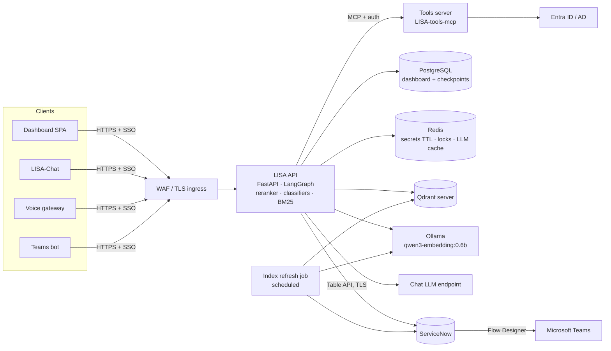

# LISA-Backend — Production Hosting Tech Stack (Local VMs / AWS / Azure)

This document is for running `LISA-Backend-playbooks-v2` in production. It was written after
reading every module in `src/`, `scripts/`, `notebooks/` and `tests/`, not only the docs. The column
order is the same throughout: **Local VMs | AWS | Azure**.

- **Section 1:** what the code does at runtime. These are the facts that drive the hosting choices.
- **Section 2:** the target production architecture.
- **Section 3:** the production tech stack, one column per environment.
- **Section 4:** production sizing.
- **Section 5:** the code changes the POC needs before it can run in production, with file references.
- **Section 6:** which environment to pick.

---

## 1. What the code does at runtime

### 1.1 One process holds everything

- **The backend:** `dashboard_backend.main:app`, a FastAPI app on port 8000. **Every route runs the
  LangGraph graph synchronously inside the HTTP request** (`servicenow_workflow.app.invoke(...)`
  in `routers/servicenow_queue.py`, `followup.py`, `voice_intake.py`, `human_review.py`).
- **A single request can be slow.**
  - The staged flow makes about 2–11 LLM calls per ticket (`Workflow.md` §7).
  - Agent mode allows up to `AGENT_MAX_STEPS=24` model calls per round.
  - The reranker runs on CPU.
  - `HANDOFF.md` records about a 75-second wait in one path.
- **Models load at import time, not lazily.**
  - `ci_classifier_agent.py`, `priority_predictor_agent.py` and `kb_search_agent.py` each call
    `...Service.from_settings()` at module level.
  - At start-up that loads 2 scikit-learn classifiers, 3 BM25 `.joblib` indexes, the
    Qwen3-Reranker-0.6B weights (torch, CPU) and 3 Qdrant connections.
  - A cold start therefore takes a while and needs a readiness check.
- **Files read at runtime** (they must ship with the image):
  - `src/resolution_engine/artifacts/**`. These are not in the repo, and the app fails at import
    without them.
  - The reranker weights folder (`QWEN_RERANKER_MODEL_PATH`).
  - `notebooks/cleaned/cmdb_ci_app_clean.json`, read by `context_extraction_agent.py:24`.
  - `src/incident_graph/playbooks/**`, re-read from disk on every call (`playbooks/loader.py`).
  - `src/incident_graph/mock_cmdb_servers.json` (`cmdb_lookup.py`; `CMDB_LOOKUP=mock` is the default).
- **Settings come from `.env` in the current working directory.** `incident_graph/__init__.py`
  calls `load_dotenv()`, and each resolution-engine `settings.py` uses `env_file=".env"`.

### 1.2 State the POC keeps, and where

| State | Where in the POC | Why it matters in production |
|---|---|---|
| Incidents, token usage, traces, reporter profiles, reporter history, similar/KB matches, full incident state JSON (9 tables) | `data/dashboard.sqlite` (`incident_graph/db.py`) | Holds **PII**: reporter mobile phone, location and name in `reporter_profiles`, plus the full state in `incident_json` and `trace_steps.full_state`. One file with a `threading.Lock` per process means a single instance only |
| LangGraph checkpoints (a paused ticket resumes hours later) | `data/checkpoints.sqlite` (`workflows/common.py:make_checkpointer`) | Stores the reporter's replies as graph inputs, including identity-check answers (the `password_reset.py` docstring says so). Needs encryption and retention rules |
| LLM response cache | Process memory (`LLM_CACHE_BACKEND=memory`) or `data/llm_cache.sqlite` | Per process, lost on restart |
| Password-reset secrets (identity answers, session token, temporary password) | **Process memory**, 15-minute TTL (`password_reset.py`) | A second replica or a restart loses an in-flight reset. Needs a shared, encrypted store |
| "Resume in progress" lock per ticket | **Process memory** (`routers/followup.py:_threads_currently_resuming`) | Does not protect across replicas |
| Tools-server schema cache | Process memory, 5 minutes (`tools_client.py`) | Fine per process |

### 1.3 What it connects to

| Direction | System | How (from the code) |
|---|---|---|
| Out | **ServiceNow** Table API | `requests`, HTTP Basic auth, **`verify=False`** (TLS checks off, `servicenow_client.py:59`). **Reads:** incident, caller profile (`caller_id.*`), work notes and comments journals, `cmdb_ci_server` (when `CMDB_LOOKUP=live`). **Writes:** `cmdb_ci`, `work_notes`, `comments` (customer-visible), `state=6` + `close_notes` (resolve), and the custom fields `u_followup_question` / `u_followup_kind` (`servicenow_teams_followup.py`) |
| Out | **Chat LLM** | `LLM_PROVIDER`: • `azure_llm` — `AzureChatOpenAI`; today's `.env.example` points at an APIM gateway (`api-genai-devtest-…azure-api.net`) • `ollama` — `ChatOllama` with **`base_url` hard-coded to `localhost`**, `common.py:69` • `claude_agent_sdk` — spawns the `claude` CLI per call with `bypassPermissions` Agent mode (`WORKFLOW_MODE=agent`) refuses anything but `azure_llm` (`agentic/agent.py:get_model`) |
| Out | **Ollama** `/api/embed` (`qwen3-embedding:0.6b`) | `OLLAMA_BASE_URL`; called on every classify and KB search |
| Out | **Qdrant** | 3 collections: `historical_incidents` (CI), `historical_incidents` (priority — **same name, different payload**), `knowledge_base_articles`. No API key or TLS option in the code. If `QDRANT_URL` is unreachable it **silently falls back** to the embedded on-disk store (`*/vector_search_store.py:from_settings`) |
| Out | **Tools server** (`LISA-tools-mcp`) | MCP over streamable HTTP, `MCP_SERVER_URL` (default `127.0.0.1:8100/mcp`), **no authentication**. Tools: `lookup_staff_name`, `start_password_reset`, `check_date_completeness`, `submit_password_reset_answers`, `check_account_status`, `clear_chrome_cache`. Today it is backed by a mock staff directory, and `CHROME_CLEAR_MODE=real` clears the browser **on the machine the tools server runs on** |
| In | **React dashboard** (`../LISA-Frontend`) | All `/api/*` routes. **No authentication.** CORS allows only `localhost:5173` |
| In | **Voice gateway** (`itsm-voice-gateway`) | `/api/voice/start`, `/continue`, `/relabel`. The gateway uses **Azure Communication Services Call Automation** (`voice_intake.py` docstring) |
| In | **Chat UI** (`../LISA-Chat`), **Teams bot** (`teams_bot/`) | The follow-up API (`/api/followup/*`) |
| Out → Teams | **ServiceNow Flow Designer → Teams** | The backend writes `u_followup_question` / `u_followup_kind`, and a ServiceNow flow sends the Teams card. The main graph uses it for resolution notices (`resolution_notice.py`). The `/api/teams/*` reply router exists but is **not registered** in `main.py` |
| — | LangSmith | `LANGSMITH_API_KEY` is in `.env.example`, but tracing is not switched on (`LANGSMITH_TRACING` is never set) |

---

## 2. Target production architecture

**What changes from the POC:** SQLite becomes PostgreSQL, in-memory secrets and locks move to Redis,
Qdrant becomes a required server, every client signs in through SSO, and a scheduled job keeps the
KB and incident indexes fresh. The API stays one container image (it holds the reranker, the
classifiers and BM25) and scales by adding replicas once the state above is moved out.

---

## 3. Production tech stack

### 3.1 Compute and runtime

| Component | Local (Virtual Machines) | AWS | Azure |
|---|---|---|---|
| **OS / container runtime** | RHEL 9 or Ubuntu 24.04 LTS VMs (VMware / Hyper-V). Docker Engine or Podman; k3s or RKE2 if you want orchestration | Amazon ECS (Fargate for the API, EC2 capacity only if you add a GPU) | Azure Container Apps (Dedicated workload profile), or AKS if the organisation standardises on Kubernetes |
| **Container image** | Python 3.12 slim, `uv sync --frozen`, **CPU-only torch wheel**. Artifacts, reranker weights, playbooks and `cmdb_ci_app_clean.json` baked in. Stored in Harbor / Artifactory | Same image. Stored in Amazon ECR (image scanning on) | Same image. Stored in Azure Container Registry (Defender scanning on) |
| **LISA API** (FastAPI + uvicorn, LangGraph, reranker, classifiers, BM25 in-process) | 2+ app VMs behind the load balancer. One uvicorn worker per container, since each worker loads its own copy of the models | ECS service, 2+ tasks across 2 AZs, behind an ALB | Container App, 2+ replicas across zones, behind Front Door / Application Gateway |
| **Long-running requests** (a turn can take minutes) | Nginx / HAProxy `proxy_read_timeout` ≥ 300 s | ALB idle timeout ≥ 300 s (configurable up to 4000 s) | Container Apps HTTP ingress has a **240 s maximum** request time, and Application Gateway defaults to 20 s. Raise the gateway timeout, and **move to async jobs** (section 5, S1) before relying on Container Apps |
| **Async job queue** (recommended, code change S1) | RabbitMQ or Redis Streams + worker containers | Amazon SQS + ECS worker service | Azure Service Bus + Container Apps worker (KEDA scaling on queue length) |
| **Load balancer / WAF / TLS** | F5 / HAProxy / Nginx + corporate CA certificates; WAF (F5 ASM or ModSecurity) | ALB + ACM certificates + AWS WAF | Azure Front Door Premium (WAF) or Application Gateway WAF v2 + managed certificates |

### 3.2 AI models

| Component | Local (Virtual Machines) | AWS | Azure |
|---|---|---|---|
| **Chat LLM** | **vLLM** on a GPU server serving an open-weights instruct model with tool calling (e.g. Qwen3 family). OpenAI-compatible API. Needs code change M6. Ollama is fine for a pilot but not for concurrent production load | **Amazon Bedrock** (e.g. Claude Sonnet) via `langchain-aws` `ChatBedrockConverse`. Needs code change M6. Or keep calling Azure OpenAI across clouds (works today, no code change) | **Azure OpenAI `gpt-4o`** (production deployment) behind the production APIM gateway. **Works today** (`LLM_PROVIDER=azure_llm`), agent mode included |
| **Agent mode** (`WORKFLOW_MODE=agent`) | Needs code change M6 (agent mode is locked to `azure_llm`) | Needs code change M6, or Azure OpenAI across clouds | Native |
| **`claude_agent_sdk` provider** | Not for production. It spawns the `claude` CLI per call with `bypassPermissions` and needs an interactive login | Not for production | Not for production |
| **Embeddings** — Ollama `qwen3-embedding:0.6b` (required: the indexes were built with it) | Ollama container, CPU (4 vCPU), 2 instances | Ollama on ECS Fargate (4 vCPU / 8 GB), 2 tasks, internal only | Ollama on Container Apps (4 vCPU / 8 GB), 2 replicas, internal ingress |
| **Reranker** — Qwen3-Reranker-0.6B (torch) | In the API container, on CPU. Scale with replicas: the code reranks one request at a time per process (lock) | In the API task, on CPU | In the API replica, on CPU |
| **Reranker on GPU** (optional; needs code change S6, since the code never moves the model to a GPU) | GPU VM (1× L4 / A10 class) | ECS on `g6.xlarge`, or a SageMaker real-time endpoint | Container Apps serverless GPU, or an Azure ML managed online endpoint |
| **CI + priority classifiers** (scikit-learn 1.9.1 pickles) and **BM25 indexes** | In the API container, baked into the image | In the API task | In the API replica |
| **Model / index versioning** | Image tag = model version; MLflow registry if retraining is automated | Image tag in ECR + versioned S3 bucket for artifacts | Image tag in ACR + Blob Storage (versioning on) for artifacts |

### 3.3 Data

| Component | Local (Virtual Machines) | AWS | Azure |
|---|---|---|---|
| **Relational DB** — replaces `dashboard.sqlite` and `checkpoints.sqlite` (code change M1) | PostgreSQL 16, primary + streaming replica (Patroni), encrypted disks, pgBackRest | **Amazon RDS for PostgreSQL**, Multi-AZ, KMS encryption, automated backups + PITR | **Azure Database for PostgreSQL – Flexible Server**, zone-redundant HA, CMK encryption, PITR |
| **LangGraph checkpointer** | `langgraph-checkpoint-postgres` on the same cluster | Same, on RDS | Same, on Flexible Server |
| **Redis** — reset secrets (encrypted, 15 min TTL), per-ticket resume lock, shared LLM cache (code change M2) | Redis 7 with Sentinel (3 nodes), TLS + ACL | Amazon ElastiCache (Valkey / Redis OSS), Multi-AZ, TLS + auth | Azure Managed Redis, zone-redundant, TLS + Entra auth |
| **Vector DB** — Qdrant server (required in production; code change M5) | Qdrant on VMs with SSD (3-node cluster for HA), API key + TLS, nightly snapshots | Qdrant on ECS / EC2 with EBS gp3 + snapshots to S3, **or** Qdrant Cloud (AWS region) | Qdrant on AKS / Container Apps with Managed Disk + snapshots to Blob, **or** Qdrant Cloud (Azure region) |
| **Index refresh** — new KB articles and closed incidents. **There is no pipeline in this repo**: the indexes are frozen artifacts from the separate CI / Priority / KB training projects | Scheduled job (cron / Airflow / Rundeck): ServiceNow → embed with Ollama → upsert Qdrant + rebuild BM25 `.joblib` | ECS scheduled task (EventBridge Scheduler) | Container Apps Job (scheduled) |
| **Retraining** (CI / priority classifiers) | Scheduled job on a VM; models into MLflow | SageMaker Pipelines or an ECS task on a schedule | Azure ML pipeline on a schedule |
| **Backups / DR** | pgBackRest + Qdrant snapshots + VM backups (Veeam) to a second site | AWS Backup (RDS, EBS) + cross-region copy | Azure Backup + geo-redundant backups, Qdrant snapshots to GRS Blob |

### 3.4 Integrations

| Component | Local (Virtual Machines) | AWS | Azure |
|---|---|---|---|
| **ServiceNow** (production instance; `.env.example` points at a test instance) | Egress through the corporate proxy. OAuth 2.0 (client credentials) or a least-privilege integration user. **TLS verification on** (code change M3) | Egress through a NAT Gateway with an **Elastic IP allow-listed** in ServiceNow IP access control | Egress through a NAT Gateway with a **static public IP allow-listed** in ServiceNow |
| **ServiceNow → Teams relay** (`u_followup_question` / `u_followup_kind` + Flow Designer + Teams spoke) | Lives in ServiceNow — the same for all three. Create the custom fields and the flow on the production instance | Same | Same |
| **Teams bot** (`teams_bot/`, separate package) | Needs a public HTTPS endpoint (DMZ reverse proxy) plus an **Azure Bot Service** registration and Entra ID app (Teams requires these whatever the hosting) | ECS service behind a public ALB, plus Azure Bot Service registration | Container Apps / App Service, plus Azure Bot Service (native) |
| **Voice** (`itsm-voice-gateway`) | It is built on **Azure Communication Services**, an Azure SaaS. Keep ACS (calls go out to Azure), or rebuild on an on-prem SIP/PBX | Keep ACS across clouds, or rebuild on Amazon Connect (large change) | ACS (native) |
| **Tools server** (`LISA-tools-mcp`) | Internal-only VM / container. Add authentication (code change M8). Back it with the **real directory** (AD / Entra ID) instead of the mock | ECS service in a private subnet (Service Connect), with authentication | Container Apps, internal ingress only, with authentication; Microsoft Graph for Entra ID resets |
| **Dashboard SPA** (React + Vite) | Nginx serving the static build | S3 + CloudFront (OAC) | Azure Static Web Apps, or Blob + Front Door |

### 3.5 Security

| Component | Local (Virtual Machines) | AWS | Azure |
|---|---|---|---|
| **User sign-in** (none in the code today; code change M4) | oauth2-proxy / Nginx with Entra ID or AD FS (OIDC) | ALB OIDC authentication against Entra ID (or Cognito federated to it) | Container Apps / App Service built-in auth with Entra ID |
| **Service-to-service auth** (voice gateway, Teams bot, chat → API) | mTLS or client-credential tokens | IAM roles + API keys in Secrets Manager, or Entra ID client credentials | Managed identities + Entra ID app roles |
| **Secrets** (ServiceNow, LLM key, Teams key, tools-server token) | HashiCorp Vault (injected at start-up) | AWS Secrets Manager → ECS task secrets | Azure Key Vault + managed identity (`azure-identity` is already a dependency) |
| **Network isolation** | VLANs + firewall: Postgres, Redis, Qdrant, Ollama and tools server not reachable from user networks | VPC with private subnets, security groups, VPC endpoints (S3, ECR, Secrets Manager, Bedrock) | VNet-integrated Container Apps environment, Private Endpoints (Postgres, Redis, Key Vault, OpenAI, ACR) |
| **PII at rest** (reporter phone / location, conversation state, identity answers in checkpoints) | Encrypted disks + PostgreSQL TDE (or pgcrypto), retention job | KMS-encrypted RDS / EBS / S3, retention job | CMK-encrypted Postgres / Blob, retention job |
| **LLM data handling** | Stays on-prem | Bedrock in the approved region | Azure OpenAI in the approved region behind APIM (content filtering, logging policy) |

### 3.6 Operations

| Component | Local (Virtual Machines) | AWS | Azure |
|---|---|---|---|
| **Logs** (the app uses `print()` → stdout) | Promtail → Loki → Grafana (or ELK) | CloudWatch Logs | Log Analytics workspace |
| **Metrics and traces** | OpenTelemetry → Prometheus + Grafana / Tempo | OpenTelemetry → CloudWatch + X-Ray | OpenTelemetry → Application Insights |
| **LLM tracing** (prompts, tool calls, token cost) | Self-hosted Langfuse (keeps PII on-prem) | Self-hosted Langfuse, or LangSmith if allowed | Self-hosted Langfuse, or LangSmith if allowed |
| **Health checks** | Liveness `/api/health`; readiness built on the existing `check_model_health()` + `check_qdrant_health()` (code change S4) | Same → ALB target group + ECS health check | Same → Container Apps liveness / readiness probes |
| **Alerting** | Grafana alerts → on-call | CloudWatch alarms → SNS / PagerDuty | Azure Monitor alerts → Action Groups |
| **CI/CD** | GitLab CI / Jenkins: ruff, offline `pytest` (the default excludes `llm` tests), image build + scan, deploy with Ansible | GitHub Actions / CodePipeline → ECR → ECS blue/green (CodeDeploy) | GitHub Actions / Azure DevOps → ACR → Container Apps revisions (traffic split) |
| **Infrastructure as code** | Ansible + Terraform (vSphere provider) | Terraform or AWS CDK | Terraform or Bicep |

---

## 4. Production sizing

These are starting points for a moderate ticket volume. Load-test before go-live. The API size is
driven by torch + the reranker + the classifiers + BM25, all held in memory per replica.

| Component | Local (Virtual Machines) | AWS | Azure |
|---|---|---|---|
| **LISA API** (per replica, min 2) | 4 vCPU / 16 GB | Fargate 4 vCPU / 16 GB | Container Apps D4 profile (4 vCPU / 16 GB) |
| **Ollama embeddings** (min 2) | 4 vCPU / 8 GB | Fargate 4 vCPU / 8 GB | 4 vCPU / 8 GB |
| **PostgreSQL** | 2× (4 vCPU / 16 GB / 200 GB SSD) | RDS `db.m7g.xlarge`, Multi-AZ | Flexible Server General Purpose `D4ds_v5`, zone-redundant HA |
| **Redis** | 3× (2 vCPU / 4 GB) | ElastiCache `cache.m7g.large`, Multi-AZ | Azure Managed Redis, Balanced B1 or larger |
| **Qdrant** (the indexes are small: ~17k incidents + KB) | 3× (2 vCPU / 8 GB / 100 GB SSD) | 3× `m7i.large` or the smallest Qdrant Cloud HA tier | 3× `D2s_v5`, or the smallest Qdrant Cloud HA tier |
| **Tools server** | 2 vCPU / 4 GB | Fargate 1 vCPU / 2 GB | 1 vCPU / 2 GB |
| **Chat LLM** | GPU server(s) sized to the chosen model and concurrency (e.g. 2× 48–80 GB GPUs for a ~30B model) | Bedrock on-demand (no servers); provisioned throughput if volume needs it | Azure OpenAI Standard or Provisioned (PTU) deployment |

---

## 5. Code changes the POC needs before production

Each item was found in the code. **M** = must do before go-live, **S** = should do.

| # | Change | Where | Why |
|---|---|---|---|
| **M1** | SQLite → PostgreSQL for the dashboard tables and the LangGraph checkpointer | `incident_graph/db.py` (SQLite `PRAGMA`, `strftime`, a process-level `threading.Lock`), `workflows/common.py:make_checkpointer` (`SqliteSaver`) | One file, one process; no HA, no scale-out |
| **M2** | In-memory state → Redis | `password_reset.py` (`_slots`), `routers/followup.py` (`_threads_currently_resuming`), `workflows/common.py` (`InMemoryCache`) | Multiple replicas and restarts break resets, locks and the cache |
| **M3** | Turn TLS verification back on for ServiceNow; stop silencing the warning; use the production instance and least-privilege credentials | `servicenow_client.py:59` (`verify=False`), `dashboard_backend/main.py:8` | Man-in-the-middle risk on a privileged integration |
| **M4** | Authentication on every API route; take the reviewer's name from the signed-in user, not the request body | `dashboard_backend/main.py`; `routers/human_review.py` (`req.reviewer_name`) | Anyone on the network can run, approve or close tickets today |
| **M5** | Qdrant: fail fast instead of falling back to the embedded store; add API key + TLS; **rename the priority collection** (it shares `historical_incidents` with the CI collection but has a different payload) | `resolution_engine/*/vector_search_store.py:from_settings`, `priority_predictor/settings.py:39` | Silent fallback hides outages; the name clash breaks priority evidence on a shared server (when `PRIORITY_EVIDENCE_FROM_CI=0`) |
| **M6** | LLM provider: make the Ollama URL configurable; add an OpenAI-compatible (vLLM) and/or Bedrock provider; allow agent mode with any tool-calling model; drop `claude_agent_sdk` from production | `workflows/common.py:47-73`, `agentic/agent.py:get_model` | `ChatOllama` is hard-coded to `localhost`; agent mode only accepts `azure_llm` |
| **M7** | Dependencies: declare `mcp`, `pyyaml` and `python-dotenv` directly; remove the missing workspace member; drop packages the code never imports (`spacy`, `gradio`, `playwright`, `sentence-transformers`, `fastembed`, `langextract`, `presidio-*`, `detoxify`, `agent-framework-*`, `lettucedetect`, `matplotlib`, `jupyter`, `langgraph-cli`); use the CPU-only torch wheel | `pyproject.toml` | `mcp` (needed by `tools_client.py`) only arrives through `claude-agent-sdk` today. `[tool.uv.workspace]` names `scripts/foundry_hosted_langchain/...`, which is not in the project, so a clean CI build can fail. A smaller image means faster deploys and fewer CVEs |
| **M8** | Tools server: add auth to the MCP client; connect the server to the real directory; set `CHROME_CLEAR_MODE=simulate` or `off` until the clear can target the reporter's PC | `incident_graph/tools_client.py`, `browser_fix.py` (default `real`), `LISA-tools-mcp` | No auth on a password-reset API; `real` clears the server's own browser |
| **M9** | Remove hard-coded values: CORS origins, the ServiceNow queue assignee | `dashboard_backend/main.py:38`, `routers/servicenow_queue.py:26` (`ASSIGNED_TO = "FN_S486176"`) | Only works for one developer on localhost |
| **M10** | Ship the runtime data files in the image and set `CMDB_LOOKUP=live` | `notebooks/cleaned/cmdb_ci_app_clean.json`, `playbooks/`, `mock_cmdb_servers.json`, `cmdb_lookup.py` | Without the JSON, application names are silently not recognised; the CMDB check uses a mock list |
| **M11** | Decide the Teams reply path: register `routers/teams_webhook.py` (it drives the older `servicenow_workflow_teams` graph), or have the Teams bot use `/api/followup/*` only | `dashboard_backend/main.py` | The reply router exists but is not reachable |
| **S1** | Run graph turns as background jobs (queue + worker); the API returns 202 and the client polls or receives a callback | All routers that call `app.invoke` | Long requests hit gateway timeouts (Container Apps 240 s cap) and tie up threads |
| **S2** | Data retention and minimisation: purge or redact `incident_json`, `trace_steps.full_state`, old checkpoints and `reporter_profiles` on a schedule | `db.py`, the checkpointer | PII and identity answers kept indefinitely |
| **S3** | Structured logging (JSON, incident ID, no PII) instead of `print()` | Throughout | Log search, alerting and audit |
| **S4** | Readiness endpoint built on `check_model_health()` and `check_qdrant_health()`; load the models before marking ready | `dashboard_backend/ollama_health.py` | Traffic currently arrives before the models are loaded |
| **S5** | Index-refresh and retraining pipeline (KB articles, closed incidents) with versioned artifacts | New job | KB answers go stale; nothing updates the indexes today |
| **S6** | Optional GPU for the reranker (`model.to(device)`) | `resolution_engine/_shared_qwen_reranker_cache.py` | Throughput, if CPU reranking becomes the bottleneck |
| **S7** | `/api/resolution-engine` reads checkpoint state and writes two tables for **every** incident on each GET; paginate it and stop writing on reads | `routers/resolution_engine.py` | Slows down as incidents grow |

---

## 6. Which environment to pick

| If… | Pick | Notes |
|---|---|---|
| The organisation already runs Azure OpenAI (APIM), Teams, Entra ID and ACS — as this code assumes | **Azure** (recommended) | Least change. Azure OpenAI, agent mode, Teams, ACS voice and Key Vault / managed identity are native. Do M1–M11; move to async jobs (S1) because of the 240 s Container Apps limit |
| Data must stay on-premises | **Local VMs** | Needs a GPU server for the chat LLM (vLLM) and code change M6. Teams still needs an Azure Bot registration, and voice still uses ACS unless it is rebuilt |
| AWS is mandated | **AWS** | Bedrock needs code change M6, or keep Azure OpenAI across clouds. Teams and ACS voice remain Azure dependencies |
