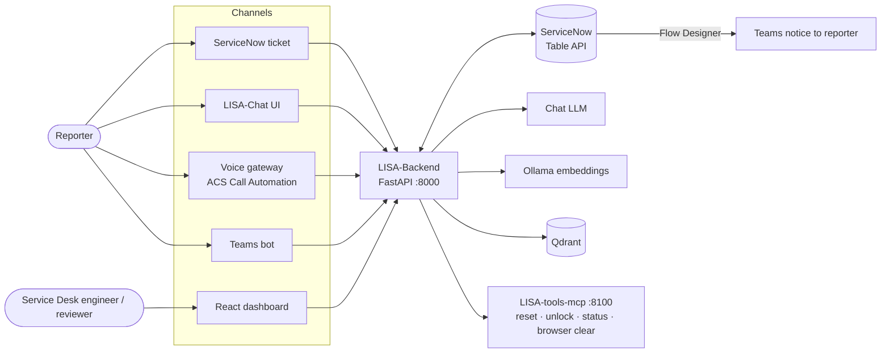
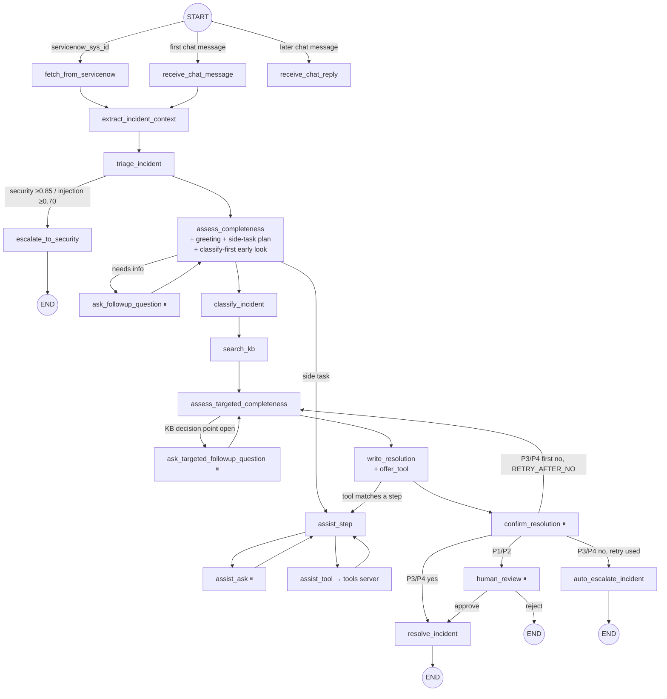

# LISA-Backend — Technical Blueprint

Written from a full read of the code in `LISA-Backend-playbooks-v2` (`src/`, `scripts/`,
`notebooks/`, `tests/`). It describes how the system is built today (POC). Hosting and the
production changes are in [`LISA-Backend-hosting-techstack.md`](LISA-Backend-hosting-techstack.md).

---

## 1. Purpose

LISA is an AI agent that triages IT incidents end to end:

1. It reads a ServiceNow ticket, or a chat or voice message.
2. It asks the reporter the missing questions.
3. It predicts the affected system (CI) and the priority.
4. It finds the matching knowledge article and drafts self-help steps.
5. It runs safe side tasks: an identity-verified password reset or unlock, and a browser-data clear.
6. It then either closes the ticket or hands it to IT Service Desk (or a human reviewer) with a full
   summary written back to ServiceNow.

**Stack:** Python 3.12–3.13, LangGraph + LangChain, FastAPI, scikit-learn, torch / transformers,
Qdrant, `rank-bm25`, Ollama (embeddings), and an LLM from Azure OpenAI, Ollama or the Claude Agent SDK.

---

## 2. System context



| External system | Role |
|---|---|
| ServiceNow | Source of tickets and the reporter profile; target of CI updates, work notes, customer comments and resolution |
| Chat LLM | Triage, questions, summary, draft, reply checks, agent loop |
| Ollama | `qwen3-embedding:0.6b` embeddings for all vector searches |
| Qdrant | Vector indexes: historical incidents and KB articles |
| LISA-tools-mcp | MCP server with the side-task tools (today: mock staff directory) |
| Voice gateway / Chat UI / Teams bot / dashboard | Clients of the REST API |

---

## 3. Component architecture

```
src/
├── dashboard_backend/        REST API (FastAPI) - thin layer over the graph and the db
│   ├── main.py               app, CORS, routers, /api/health
│   ├── routers/              servicenow_queue · followup · voice_intake · human_review · incidents
│   │                         dashboard_overview · resolution_engine · token_usage · trace · teams_webhook (not registered)
│   ├── interrupts.py         turns a graph pause into the reporter-facing message
│   ├── servicenow_sync.py    writes answers / confirmations / escalations back as work notes
│   ├── agentic_chat.py       resume payloads for agent mode
│   └── ollama_health.py      model + Qdrant health (gates every run)
├── incident_graph/           the agent
│   ├── workflows/            servicenow_workflow.py (staged graph) · servicenow_workflow_teams.py (older copy)
│   │                         intake_nodes · core_nodes · assist_nodes · common (LLM, cache, checkpointer)
│   ├── agentic/              WORKFLOW_MODE=agent: agent.py (loop) · tools.py (8 tools) · workflow.py
│   ├── agents/               one module per step: triage · context_extraction · completeness · classification
│   │                         ci_classifier · priority_predictor · priority_policy · kb_search · similarity_search
│   │                         targeted_followup · shared_guidance (prompt text)
│   ├── playbooks/            markdown rulebook (common / categories / families / cis / flows) + loader + checker
│   ├── servicenow_client.py  Table API client (retries, display values)
│   ├── tools_client.py       MCP client to LISA-tools-mcp (+ tool catalog, schemas, facts)
│   ├── password_reset.py     in-memory secret slots + yes/no / staff-id parsing
│   ├── db.py                 dashboard.sqlite (9 tables)
│   └── classify_first · access_request · question_queue · greeting · resolution_notice · asset_note
│       browser_fix · cmdb_lookup · priority_recheck · flight_reply · work_note_summary · ...
└── resolution_engine/        trained models + search, no LLM
    ├── ci_predictor/         TF-IDF + calibrated SVM  ∥  hybrid search + rerank  → reconciliation
    ├── priority_predictor/   two-stage LinearSVC (urgency gate + split models), CI as a feature
    ├── kb_retrieval/         hybrid KB search + rerank
    ├── _shared_qwen_reranker_cache.py   one Qwen3-Reranker-0.6B per process
    └── _artifact_compat.py   module aliases so the training projects' pickles load
```

**Supporting folders:**
- `scripts/`: `replay_playbooks.py` (offline replay of the playbooks against recorded incidents)
  and `compare_azure_rerank.py` (Qwen versus gpt-4o reranker A/B).
- `notebooks/`: the reference graph notebook, the CMDB cleaning notebook, the LettuceDetect
  evaluation, and `cleaned/cmdb_ci_app_clean.json` (read at runtime).
- `tests/`: 32 test files, 557 offline tests. The `llm` marker is excluded by default.

---

## 4. Incident lifecycle — staged graph (`WORKFLOW_MODE` unset / `graph`)



⏸ marks a LangGraph `interrupt()`: the run pauses, the state is checkpointed, and an HTTP call
resumes it later (even days later).

### Agent mode (`WORKFLOW_MODE=agent`, `incident_graph/agentic/`)

Intake, context, triage, assist and the ending nodes are the same. The staged questions loop
(`assess_completeness` … `write_resolution`) is replaced by:

1. **`agent_model`:** one tool-calling model call, needs `azure_llm`.
2. **`agent_tools`:** runs ONE tool per visit. The tools are `get_missing_info`, `ask_user` (an
   interrupt), `classify_incident`, `search_kb`, `park_issue`, `request_person`, `offer_assist` and
   `finish`.
3. **`agent_gate`:** checks the agent's final decision against the real tool log, then hands over
   to `write_resolution` / `confirm_resolution` / `human_review` / `resolve_incident` /
   `auto_escalate_incident`.

**Limits:** `AGENT_MAX_STEPS` (default 24) model calls per round and `AGENT_MAX_QUESTIONS`
(default 4) free questions. Any jump to a node the agent graph does not have becomes an escalation
(the `safe()` wrapper).

### Every way an incident can end

| Situation | Ends as |
|---|---|
| KB found, P3/P4, reporter says fixed | Resolved automatically |
| KB found, P3/P4, reporter says not fixed (after one retry) | Escalated to Service Desk |
| Any P1/P2 | Human review → resolved or escalated |
| No KB article | P3/P4 escalated · P1/P2 human review |
| Gate incident | Fixed gate escalation text → as above |
| Security (≥ 0.85) or prompt injection (≥ 0.70) | Stopped, escalated to Security |
| Request-only fix (e.g. "email team X") | Resolved without a confirmation (P3/P4); reporter notified by comment + Teams |
| Password reset / unlock done (identity verified) | Resolved (or "is the original problem fixed?" when there is a second problem) |
| Identity check failed / unknown staff ID | Escalated |
| Reporter asks for a person | P1/P2 human review · P3/P4 escalated |

---

## 5. Decision logic

### 5.1 Triage (`agents/triage_agent.py`, 1 LLM call)

- **Category:** one of 8 (`hardware`, `application`, `identity_access`, `network`,
  `email_collaboration`, `infrastructure`, `security`, `common`), plus a runner-up and a confidence.
  Below 0.75 the reporter gets one clarifying question.
- **Preliminary priority:** P1–P4.
- **Guardrails:**
  - Injection risk ≥ 0.70 → stop.
  - Secret risk ≥ 0.60 → the credential is masked (regex + the model's verbatim span) and the
    ticket continues.
  - Security category ≥ 0.85 → stop.
- **Assist reading:** `wants_password_reset`, `password_scope`, `account_action`,
  `wants_browser_clear`, `wants_browser_steps`, `suggested_tool` (picked from the live tool
  catalog) and `separate_technical_problem`.
- **Verbatim-only extraction:** location and flights are kept only if they appear word for word in
  the text.

### 5.2 Context extraction (`agents/context_extraction_agent.py`, no LLM)

- **Pattern matching (regex):** assets (PC / NB, printers PR, PDA HH, crew iPhone / tablet SP / TB),
  server names, REQ / RITM, KB numbers, URLs, personal-device signals, and the application (matched
  against `cmdb_ci_app_clean.json`).
- **ServiceNow profile:** the caller's staff number, preferred name, title, location, mobile phone,
  last login and language, plus work notes and comments.
- **Long-term memory per reporter:** known phone, location, apps used, most frequent CI and the
  last 5 issues (`reporter_profiles` / `reporter_incident_history`).

### 5.3 Classification (`agents/classification_agent.py`)

```
incident text (+ follow-up answers)
   ├─ LLM (1 call): summary + policy signals (department, check-in down, active flight, gate devices, multiple users, hardware / network)
   ├─ embedding (Ollama, once, shared)
   ├─ CI fast guess: SVM only  ──► feature for the priority model
   ├─ hybrid search (Qdrant vectors + BM25, RRF)  ──► Qwen3 rerank (10 candidates)
   │      ├─► CI retrieval vote (softmax over rerank scores)
   │      └─► priority evidence (reuses these candidates; PRIORITY_EVIDENCE_FROM_CI)
   ├─ CI = reconcile(SVM, retrieval vote)  · unreliable (conflict / weak) → empty
   ├─ CI overrides: known CMDB server  >  hardware (G.G.HARDWARE-ACCESSORIES)  >  network (EGTC-WLCDC-1)
   ├─ priority = two-stage LinearSVC  →  business policy overrides (below)
   └─ similar incidents = reranked candidates with relevance ≥ 0.7 AND the same CI
```

**Priority policy** (`agents/priority_policy.py`, first match wins):

| Rule | Priority |
|---|---|
| Check-in application down | critical |
| Active flight affected | critical |
| Gate: biometric gate down | critical |
| Gate: app down on all PCs + all printers down | critical |
| Gate: one printer down | high |
| Multiple users — NCC / Contact Center | critical |
| Multiple users — gate, several gates | critical |
| Multiple users — one gate / other | high |
| Otherwise | the ML prediction |

**Classify first** (`classify_first.py`): right after triage, an early, non-persisted classification
runs. When the CI score is ≥ `CI_CONFIDENT_SCORE` (0.90), the first question round also carries up to
2 KB questions, and the real classification runs again after the answers.

### 5.4 Knowledge retrieval (`agents/kb_search_agent.py`)

1. Hybrid search scoped to the predicted CI (5 candidates), falling back to an unscoped search.
2. Qwen3 rerank.
3. Articles with relevance ≥ 0.7 are kept, up to 3 of them.

Stage 3 (`targeted_followup_agent.py`) extracts the articles' **decision points** (1 LLM call) and
asks only those not yet answered. The draft (`core_nodes.write_resolution`) must use only the KB
steps, cite KB numbers, fill in known details, and drop contact details that are not in the sources.

### 5.5 Questions

- **Stage 1** (`completeness_agent.py`) is a model question plus must-ask blocks built in code:
  clarifying category, access method, device asset, flight details, PCs per gate, printer asset,
  location, contact number.
- **One question per turn** (`ONE_QUESTION_AT_A_TIME`, max 4). After each reply, the questions that
  are already answered or irrelevant are dropped (`ONE_QUESTION_RECHECK`, `RELEVANCE_CHECK`).
- **Playbooks** add rules and trigger-word questions per category / family / CI / flow, read from
  markdown on every call.

---

## 6. Assist flows (`workflows/assist_nodes.py`)

```
assist_step (decides, no I/O) ──► assist_ask (only the pause) ──► assist_step
                               └─► assist_tool (the ONLY tools-server caller) ──► assist_step
```

| Flow | Steps | Safety controls in code |
|---|---|---|
| **Password reset / unlock** | Scope (staff ID vs another application) → staff ID (from the ServiceNow profile, or asked) → `lookup_staff_name` → (unlock: `check_account_status`) → consent → `start_password_reset` → identity questions one at a time (`check_date_completeness` for dates) → `submit_password_reset_answers` → temporary password shown or account unlocked → resolve | Allow-list of tools per task; explicit "yes" required for the reset; limits (3 lookups, 2 starts, 1 submit per start, 3 ID tries); answers, session token and password kept only in memory (15 min) and replaced by `[provided]` / a placeholder in state; never stored in work notes; a server that cannot unlock is never called for an unlock |
| **Browser-data clear** | Ask whether Chrome and Edge both fail → the browser and the PC number (from the tool's schema) → offer → yes → `clear_chrome_cache` → "is it working now?" | Consent required; `CHROME_CLEAR_MODE` = `real` / `simulate` / `off`; only the parameters the schema declares are sent |
| **Browser steps** | KB / built-in steps, with an offer to do it for them | No tool call unless they say yes |
| **Catalog tools** (`offer_tool`) | After the draft, a step that matches a tool in the server's catalog → offer → details → yes → call → verify | The tool name must come from the live catalog; the model can only suggest |
| **Side requests mid-conversation** | "it's fixed", "I want a person", "also clear my cache" | One small LLM call, only when the reply contains a trigger word; max 2 side tasks per conversation |

---

## 7. Interfaces

### 7.1 REST API (`dashboard_backend`)

| Method | Path | Purpose |
|---|---|---|
| GET | `/api/health` | Liveness |
| GET | `/api/dashboard/overview` | Counts, running incidents, system / model status |
| GET | `/api/servicenow/queue` | Open tickets for the configured assignee, not yet run |
| POST | `/api/servicenow/run-agent` | Start the agent on a ticket number |
| POST | `/api/servicenow/continue` | Resume with a reporter answer |
| GET | `/api/followup/queue` | Tickets waiting for a reporter answer (with the pending question) |
| POST | `/api/followup/{thread_id}/answer` | Answer a question |
| GET | `/api/followup/confirmations` | Tickets waiting for "did this fix it?" |
| POST | `/api/followup/{thread_id}/confirm` | Yes / no (+ detail) |
| GET | `/api/followup/notices` | Resolution notices for tickets closed without a reply |
| GET | `/api/review/queue` · `/api/review/{id}` | P1/P2 waiting for review, with context |
| POST | `/api/review/{id}/approve` · `/reject` | Reviewer decision |
| GET | `/api/incidents` · POST `/api/incidents/{id}/retry` | All incidents (filterable); retry a stuck one |
| GET | `/api/resolution-engine` | CI / priority / similar / KB per incident |
| GET | `/api/token-usage` | LLM tokens per incident and node |
| GET | `/api/trace/{thread_id}` | Step-by-step timeline from the checkpoints |
| POST | `/api/voice/start` · `/continue` · `/relabel` | Voice (and chat-shaped) intake |
| POST | `/api/teams/start` · `/reply` | Teams graph (router present, **not registered**) |

Every run or resume first checks model health and refuses when a model is down.

### 7.2 ServiceNow (`servicenow_client.py`, Table API)

| Reads | Writes |
|---|---|
| `incident` (one record; queue list by assignee + `active=true`) | `cmdb_ci` (after classification; from a confirmed KB fix) |
| `caller_id.*` profile fields | `work_notes`: answers, asset / location details, security stop, escalation summary, resolution summary |
| `sys_journal_field` (work notes + comments) | `comments` (customer-visible): resolution notice |
| `cmdb_ci_server` (`CMDB_LOOKUP=live`) | `state=6` + `close_code` + `close_notes` (resolve) |
| | `u_followup_question` / `u_followup_kind` → ServiceNow Flow → Teams |

### 7.3 LLM calls per ticket (staged flow)

| Node | Calls |
|---|---|
| `triage_incident` | 1 |
| `assess_completeness` (first entry) | 2 (greeting + question) |
| Each reply | 0–3 (queue re-check, flight extraction, reply intent when there is a trigger word) |
| `classify_incident` | 1 (+1 for the classify-first early look) |
| `assess_targeted_completeness` | 1 + 1 per round |
| `write_resolution` | 1 + 0–1 (tool pick) |
| Assist replies | 0–1 each (only when not a plain yes / no) |

Observed: about 2 calls for a password-reset ticket and about 11 for a gate-printer ticket (gpt-4o).

---

## 8. Data model

### 8.1 Graph state (`incident_graph/state.py` → `IncidentAgentState`)

| Group | Main fields |
|---|---|
| Intake | `source`, `servicenow_sys_id`, `incident_id`, `incident_description`, `reporter_email` / `name`, `logged_priority`, `messages` |
| Context | `extracted_context` (assets, location, server, application, flights, personal device, reporter profile + history) |
| Triage | `triage` (category, priorities, risks, guardrail label, assist reading) |
| Questions | `followup_question` / `answer`, `targeted_followup_question` / `answer`, question queue fields, `contact_location_confirmed` |
| Classification | `early_classification`, `ci_score`, `classification` (priority, CI, confidence, decision source, summary, policy reason, department), `policy_signals`, `similar_incidents` |
| Knowledge | `search_results` (formatted KB articles with relevance) |
| Resolution | `draft_resolution`, `has_self_service_steps`, `request_only`, `user_confirmed_resolved`, `confirm_retry_round`, `closing_message`, `resolution_notice`, `reviewed_by`, `rejection_reason` |
| Assist | `assist_tasks` / `task` / `stage` / `ctx` / `question` / `reply` / `result` / `events` / `done` / `declined`, `assist_sensitive`, `identity_failed` |
| Agent mode | Tool log in `messages`, step counters, parked issues |

### 8.2 `data/dashboard.sqlite` (`db.py`)

| Table | Contents |
|---|---|
| `incidents` | One row per thread: IDs, source, status, category, priority, CI (+ confidence, decision source), summary, reviewer, rejection reason, confirmation, sync / last error, timestamps |
| `token_usage` | Per LLM / rerank call: thread, node, input / output tokens, cache hit, model |
| `reporter_profiles` | Per reporter: name, mobile phone, location, checkout location, apps used (last 10), most frequent CI |
| `reporter_incident_history` | Per reporter: past incidents with CI and summary |
| `trace_steps` | Per step: node, label, time, elapsed, detail, **full state JSON** |
| `incident_json` | Latest full state per incident |
| `similar_incident_matches` · `kb_article_matches` | Display mirrors |

**Statuses:** `processing`, `classified`, `awaiting_reporter_info`, `awaiting_followup_answer`,
`awaiting_resolution_confirmation`, `awaiting_human_review`, `resolved`, `rejected`,
`security_escalated`, `error`.

### 8.3 Other stores

| Store | Contents |
|---|---|
| `data/checkpoints.sqlite` | LangGraph checkpoints for every thread (all state versions, including the reporter's raw replies) |
| `data/llm_cache.sqlite` | Optional LLM response cache |
| `src/resolution_engine/artifacts/` (not in the repo) | `ci_predictor/`: `configuration_item_classifier.joblib`, `keyword_search_store.joblib`, `vector_store/`<br>`priority_predictor/`: `priority_classifier.joblib`, `keyword_search_store.joblib`, `vector_store/`<br>`kb_retrieval/`: `keyword_search_store.joblib`, `vector_store/` |
| Reranker weights | `scripts/reranker/models/qwen3-reranker-0.6b` (or `QWEN_RERANKER_MODEL_PATH`) |
| Qdrant collections | `historical_incidents` (CI), `historical_incidents` (priority — same name, different payload), `knowledge_base_articles` |
| Memory (per process) | Password-reset secret slots (15 min), resume locks, LLM cache, tool-schema cache (5 min) |

---

## 9. Configuration (`.env`)

| Variable | Default in code | Effect |
|---|---|---|
| `LLM_PROVIDER` | `claude_agent_sdk` | `azure_llm` / `ollama` / `claude_agent_sdk` |
| `AZURE_LLM_BASE_URL` / `_API_KEY` / `_DEPLOYMENT` / `_API_VERSION` / `_TIMEOUT` / `_TEMPERATURE` | — / 60 / 0.2 | Azure OpenAI |
| `OLLAMA_MODEL` / `OLLAMA_TEMPERATURE` / `OLLAMA_THINKING` | `qwen3:8b` / 0 / model default | Local chat model (URL fixed to `localhost:11434`) |
| `CLAUDE_AGENT_SDK_MODEL` / `_TIMEOUT` | CLI default / 60 | Claude Agent SDK |
| `LLM_CACHE_BACKEND` | `memory` | `memory` / `sqlite` / `none` |
| `WORKFLOW_MODE` | `graph` | `agent` = agent loop |
| `AGENT_MAX_STEPS` / `AGENT_MAX_QUESTIONS` | 24 / 4 | Agent limits |
| `OLLAMA_BASE_URL` / `OLLAMA_EMBEDDING_MODEL_NAME` | `localhost:11434` / `qwen3-embedding:0.6b` | Embeddings |
| `QWEN_RERANKER_MODEL_PATH` | `scripts/reranker/models/qwen3-reranker-0.6b` | Reranker weights |
| `QDRANT_URL` | unset (embedded store) | Qdrant server |
| `SERVICENOW_INSTANCE_URL` / `_USERNAME` / `_PASSWORD` | — | ServiceNow |
| `MCP_SERVER_URL` / `TOOLS_TIMEOUT_SECONDS` | `127.0.0.1:8100/mcp` / 40 | Tools server |
| `ASSIST` / `PASSWORD_RESET` | on | Side-task flows |
| `CHROME_CLEAR_MODE` | `real` | `real` / `simulate` / `off` |
| `ONE_QUESTION_AT_A_TIME` / `ONE_QUESTION_MAX` / `ONE_QUESTION_RECHECK` / `RELEVANCE_CHECK` | on / 4 / on / on | Question behaviour |
| `ACCESS_REQUEST_FASTPATH` | on | Lockout shortcut |
| `INCIDENT_GREETING` | on | Greeting message |
| `RETRY_AFTER_NO` | on | One more round after the first "no" (P3/P4) |
| `RESOLUTION_NOTICE` / `TEAMS_NOTICE_KIND` | on / `resolution_notice` | Notify the reporter when closed without a reply |
| `CI_CONFIDENT_SCORE` | 0.90 | Classify-first threshold |
| `PRIORITY_EVIDENCE_FROM_CI` | on | Reuse the CI rerank for priority |
| `CMDB_LOOKUP` | `mock` | `mock` / `live` / `off` |
| `PLAYBOOKS_DIR` | package folder | Alternative rulebook |
| `TEAMS_WEBHOOK_API_KEY` | — | Teams router key |

---

## 10. Security and privacy

**Controls already in the code:**
- **Prompt injection:** reporter text is fenced as data in every prompt, and the injection score
  stops the workflow at ≥ 0.70.
- **Credentials:** a credential pasted in the ticket is masked before it is used.
- **Password-reset secrets** never enter the state, work notes or the dashboard; the temporary
  password is swapped in only in the HTTP reply.
- **Consent:** side-effecting tools need an explicit yes, are on an allow-list per task, and have
  call limits.
- **Model output checks:** the model can suggest a tool but never call one, and the agent's decision
  is checked against its real tool log.
- **Reporter-facing text checks** enforce "never say" rules in code (`reporter_text_checks.py`), and
  contact details not found in the sources are dropped from drafts.
- **Work notes** are internal; only the resolution notice is customer-visible.

**Gaps (POC):**
- The API has no authentication.
- ServiceNow TLS verification is off.
- The tools server has no authentication.
- PII (phone, location, full state, reporter replies) is stored in SQLite with no retention policy.
- Secrets are kept in process memory.

See the hosting document, section 5, for the fixes.

---

## 11. Deployment view

**Today (POC, one Windows machine):**

| Process | Port |
|---|---|
| uvicorn backend | 8000 |
| React dashboard | 5173 |
| LISA-tools-mcp | 8100 |
| Ollama | 11434 |
| Qdrant (Docker) | 6335 |

**Production:** the API becomes stateless replicas, backed by PostgreSQL, Redis and a Qdrant server,
with managed or self-hosted models per environment, SSO and secrets in a vault. See
[`LISA-Backend-hosting-techstack.md`](LISA-Backend-hosting-techstack.md) for the Local VMs / AWS /
Azure stack, sizing, model alternatives and the must-fix code changes (M1–M12, S1–S7).

---

## 12. Quality and testing

- **Tests:** 557 offline tests in 32 files. They cover the assist flows, the agent, questions,
  greeting, classify-first, playbooks, confirm / retry and more. Tests that need a real LLM are
  marked `llm` and excluded by default (`pytest -m llm` runs them).
- **Test isolation:** `tests/conftest.py` turns off the assist flows, the classify-first look and
  the tools-server schema fetch, so no test touches real services.
- **Playbook checks:** `python -m incident_graph.playbooks check` validates the rulebook, and
  `scripts/replay_playbooks.py` shows which recorded tickets an edit reaches.
- **Evaluation:** `notebooks/lettucedetect_eval.ipynb` covers hallucination detection on drafts, and
  `scripts/compare_azure_rerank.py` covers the reranker A/B.

## 13. Known limitations

- The ServiceNow queue is fixed to one assignee (`ASSIGNED_TO`).
- The Teams graph (`servicenow_workflow_teams.py`) is an older copy (no triage, no Stage 3), and its
  router is not registered.
- The tools server uses a mock staff directory. The Chrome clear acts on the tools server's own
  machine; `target_pc` is only recorded.
- `CMDB_LOOKUP` defaults to a mock list of servers.
- There is no pipeline to refresh the KB / incident indexes or retrain the classifiers.
- Several conversation rules are prompt instructions, so a model may occasionally ignore them. The
  critical ones (must-ask questions, masking, consent, routing) are enforced in code.
