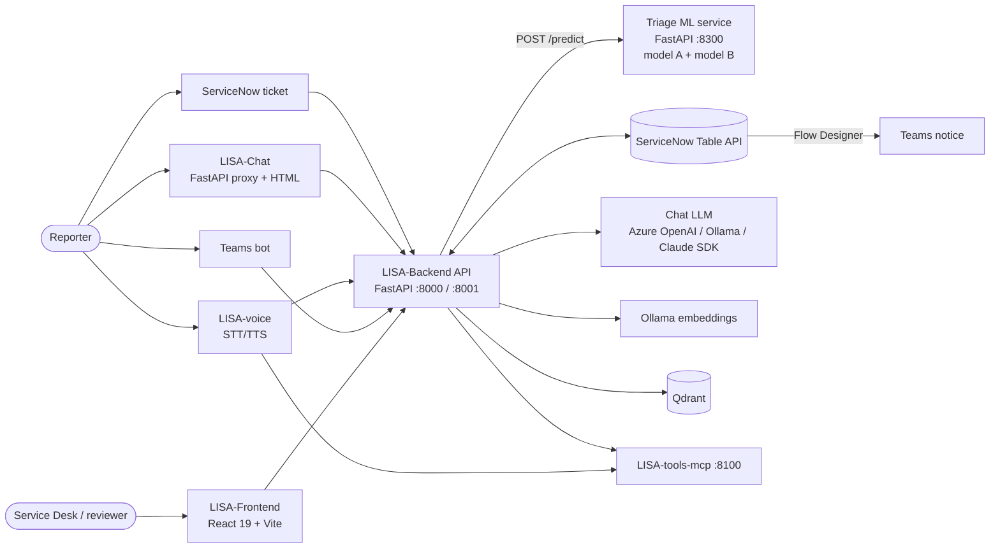
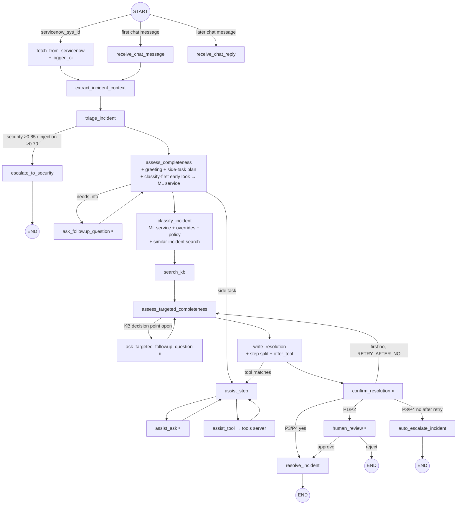

# LISA-Backend (hybrid, PROD copy) — Technical Blueprint

**Sources:**
- `LISA-Backend-playbooks-v2-hybrid-PROD`, compared file by file with
  `LISA-Backend-playbooks-v2-hybrid`. **Every file in `src/`, `models/` and `tests/` is identical**
  (0 differences, ignoring line endings), so the script-by-script read of the hybrid code applies
  unchanged.
- The combined `TECHSTACK.md` for the sibling projects.
- Some model facts come from the hybrid copy's `HYBRID_CLASSIFIER.md`, which **is not in the PROD
  copy**.

This describes the system **as built today (POC)**. Hosting is covered in
[`LISA-Backend-hybrid-PROD-hosting-techstack.md`](LISA-Backend-hybrid-PROD-hosting-techstack.md) and the
production folder layout in [`LISA-Backend-hybrid-PROD-restructure-plan.md`](LISA-Backend-hybrid-PROD-restructure-plan.md).

### What the PROD copy changes compared with the hybrid copy

The code is identical; only these files were removed from the PROD copy:

| Removed | What it was | Effect in PROD |
|---|---|---|
| `notebooks/` (incl. `notebooks/cleaned/cmdb_ci_app_clean.json`) | Research notebooks + **the CMDB application list the code reads at start-up** (`context_extraction_agent.py:24`) | **Runtime change, silent:** application names are no longer recognised in the ticket text (see §5.6) |
| `scripts/replay_playbooks.py` | Offline playbook replay tool | `playbooks/README.md` still tells maintainers to run it |
| `scripts/MLZ_Conversation.md`, `scripts/Outlook_Conversation.md` | Sample conversation transcripts | None |
| `docs/rules/` (13 files) | The playbook migration plans, move maps, inventories and coverage YAML | None at runtime |
| `AGENTIC.md`, `HYBRID_CLASSIFIER.md`, `PLAYBOOKS.md`, `HANDOFF.md`, `PLAN_reply_understanding.md`, `TECHSTACK.md` | Design and session documentation | `README.md` links to `HYBRID_CLASSIFIER.md`, `AGENTIC.md`, `PLAYBOOKS.md` and `notebooks/`; `Workflow.md` points to `AGENTIC.md` twice; `resolution_engine/README.md` points to `HYBRID_CLASSIFIER.md` — all now dead links |

Kept: `README.md`, `Workflow.md`, `.env.example`, `.gitignore` (still excludes `models/`),
`pyproject.toml`, `uv.lock`, `models/` (service code, no `.joblib` files), `src/`, `tests/`.

### What the hybrid code changes compared with v2

| Area | v2 | Hybrid |
|---|---|---|
| CI prediction | In-process: TF-IDF + SVM plus a retrieval vote, reconciled | **Triage ML service, model A** (calibrated SVM) over HTTP |
| Priority | In-process two-stage LinearSVC | **Triage ML service, model B** (stacked ensemble with XGBoost) |
| New predictions (recorded only, nothing routes on them) | — | Assignment group, category, subcategory, Major Incident risk alert, `ci_mismatch`, `auto_route` |
| Removed | — | `resolution_engine/priority_predictor/`, the CI classifier, `prediction_reconciliation.py`, `label_normalization.py`, `priority_predictor_agent.py`, `PRIORITY_EVIDENCE_FROM_CI` |
| Reranker | Qwen3-Reranker on CPU only | Qwen (default) **or the Azure chat model as a listwise reranker** (`RERANKER=azure`) |
| Similar-incident search | Feeds the CI vote and the panel | **Panel only.** Skipped in the classify-first early look |
| Draft | — | `_split_inline_steps` puts numbered steps one per line |
| New service | — | `models/`: FastAPI on port 8300 holding the two `.joblib` models |

---

## 1. Purpose

LISA triages IT incidents end to end:

1. It reads a ServiceNow ticket, or a chat or voice message.
2. It asks the reporter the missing questions.
3. It gets the CI and priority from the triage ML service, then applies business rules on top.
4. It finds the matching knowledge article and drafts self-help steps.
5. It runs safe side tasks: an identity-verified password reset or unlock, and a browser-data clear.
6. It then closes the ticket or hands it to IT Service Desk (or a human reviewer), writing a summary
   back to ServiceNow.

---

## 2. System context



| Component | Role | Stack (from the code / `TECHSTACK.md`) |
|---|---|---|
| **LISA-Backend API** | The agent and the REST API | Python 3.12–3.13, LangGraph, LangChain, FastAPI, Qdrant client, `rank-bm25`, torch + transformers (Qwen reranker) |
| **Triage ML service** (`models/`) | CI, priority, assignment group, category, subcategory, Major Incident risk alert | FastAPI, scikit-learn 1.9.1, XGBoost 3.4.1, pandas, joblib. Model A 11 MB, model B 162 MB. About 160 ms per call |
| **LISA-Frontend** | Dashboard | React 19, Vite, HeroUI, Tailwind CSS v4, TanStack Query (polls every 20 s), mock API server |
| **LISA-Chat** | Browser chat demo | FastAPI + httpx proxy to the API, plain HTML/JS, port 5174 |
| **LISA-voice** | Local voice demo | FastAPI call screen, faster-whisper STT, Silero VAD (onnxruntime), soprano-tts, sounddevice (local mic and speaker). Calls `/api/voice/*` and the tools server |
| **LISA-tools-mcp** | Side-task tools | MCP server (streamable-http, port 8100). Mock staff lookup + identity verification; Chrome / Edge clear **deletes the browser profile files on the machine it runs on** |
| **ServiceNow** | Source of tickets and target of updates | Table API |
| **Ollama** | `qwen3-embedding:0.6b` embeddings | Local |
| **Qdrant** | `historical_incidents`, `knowledge_base_articles` | Docker or embedded |

---

## 3. Component architecture (backend)

```
LISA-Backend-playbooks-v2-hybrid-PROD/
├── src/
│   ├── dashboard_backend/          REST API: main.py, routers/ (11, teams_webhook not registered), schemas, interrupts,
│   │                               servicenow_sync, agentic_chat, ollama_health, kb_format, similar_incidents_format
│   ├── incident_graph/
│   │   ├── workflows/              servicenow_workflow.py (staged graph), servicenow_workflow_teams.py (older copy),
│   │   │                           intake_nodes, core_nodes, assist_nodes, common (LLM, cache, checkpointer)
│   │   ├── agentic/                WORKFLOW_MODE=agent: agent, tools (8), events, missing, workflow
│   │   ├── agents/                 triage, context_extraction, completeness, classification, ci_classifier (overrides +
│   │   │                           similar search), kb_search, similarity_search, targeted_followup, priority_policy,
│   │   │                           query_text, shared_guidance, shared_guidance_OLD (not imported)
│   │   ├── playbooks/              markdown rulebook + loader / checker / CLI
│   │   ├── ml_triage.py            HTTP client of the triage ML service (never raises; 30 s back-off)
│   │   ├── servicenow_client.py, servicenow_teams_followup.py, tools_client.py, password_reset.py, db.py, state.py
│   │   └── classify_first, access_request, question_queue, greeting, resolution_notice, asset_note, browser_fix,
│   │       cmdb_lookup (+ mock_cmdb_servers.json), priority_recheck, flight_reply, work_note_summary, token_tracking,
│   │       reporter_text_checks, question_dedupe, ci_rules, claude_agent_sdk_llm
│   └── resolution_engine/          search only (no CI / priority models any more)
│       ├── ci_predictor/           similar-incident search: hybrid vector + BM25, reranked
│       ├── kb_retrieval/           KB search: hybrid vector + BM25, reranked
│       ├── azure_reranking_client.py   RERANKER=azure: gpt-4o listwise reranker
│       ├── _shared_qwen_reranker_cache.py, _artifact_compat.py (pickle module aliases)
├── models/                         triage ML service: app.py, model_a.py / model_b.py (generated from the training
│                                   notebooks), build_model_modules.py, check_service.py, run_service.bat, README, HOWTORUN
├── tests/                          34 test files, 893 offline tests (count from the hybrid copy's HYBRID_CLASSIFIER.md)
├── README.md, Workflow.md          the only docs in PROD (with dead links, see above)
└── (removed in PROD: notebooks/, scripts/, docs/, 6 root docs — incl. the runtime CMDB application list)
```

---

## 4. Incident lifecycle

The staged graph is **unchanged from v2** (same node names, same pauses).



⏸ marks a LangGraph `interrupt()`: the state is checkpointed, and an HTTP call resumes the run later.

**Agent mode** (`WORKFLOW_MODE=agent`, the default in `.env.example`) replaces the staged question
loop with `agent_model` ↔ `agent_tools` → `agent_gate`. It has 8 tools (`get_missing_info`,
`ask_user`, `classify_incident`, `search_kb`, `park_issue`, `request_person`, `offer_assist`,
`finish`), at most 24 model steps per round and 4 free questions, and it needs `azure_llm`. The
agent's `classify_incident` tool calls the same node, so it also calls the triage ML service.

**Ways an incident can end:**
- **Resolved:** P3/P4 with a confirmed fix, request-only fixes, or a reset / unlock done.
- **Escalated:** P3/P4 not fixed after one retry, no KB article, a failed identity check, or the
  reporter asked for a person.
- **Human review:** every P1/P2.
- **Security:** security or injection stops.

---

## 5. Decision logic

### 5.1 Triage (1 LLM call) — unchanged

- **Category:** 8 categories; below 0.75 confidence the reporter gets a clarifying question.
- **Preliminary priority:** P1–P4. It is also the **fallback priority when the ML service is down**.
- **Guardrails:** injection ≥ 0.70 stops; a secret ≥ 0.60 is masked; security ≥ 0.85 stops.
- **Assist reading:** reset / unlock / browser clear / browser steps / suggested tool / a separate
  problem.

### 5.2 Classification (`agents/classification_agent.py`)

```
incident text + follow-up answers
  ├─ LLM (1 call): summary + policy signals (department, check-in down, active flight, gate devices, multiple users, hardware/network)
  ├─ ml_triage.classify(text, impact=logged impact, submitted_ci=logged_ci)  ──►  POST :8300/predict
  │     A: cmdb_ci (+conf), major_incident_risk_alert / score / threshold, ci_mismatch
  │     B: priority (+mapped low/medium/high/critical), assignment_group, category, subcategory, auto_route
  │     status ok | partial (one model missing) | error (service down/slow/401 → 30 s back-off)
  ├─ CI = model CI if confidence ≥ ML_CI_MIN_CONFIDENCE (0.7) else blank
  │     → overrides: known CMDB server > hardware (G.G.HARDWARE-ACCESSORIES) > network (EGTC-WLCDC-1)
  ├─ priority = model priority (mapped) → else triage's preliminary priority → else medium
  │     → business policy (check-in down, active flight, gate devices, multiple users) can raise it
  ├─ similar incidents (persist=True only): embedding → Qdrant + BM25 (10) → rerank → ≥0.7 and same CI, top 5
  └─ ml_classification.applied = {ci, ci_source, priority, policy_reason}
```

**`ci_decision_source` values:**

| Value | Meaning |
|---|---|
| `hybrid_model` | The model's CI was used |
| `low_confidence_unknown` | The model was below 0.7, so the CI is blank |
| `model_error` | The service gave no CI |
| `override` / `server_cmdb` | A rule set the CI |
| `kb_confirmed` | Set later from a confirmed KB fix ≥ 0.85 |

`ml_classification.applied` is updated when the priority re-check, the targeted follow-up or a
KB-confirmed CI changes the outcome.

**Classify first:** the early look (`persist=False`) calls the ML service but skips the embedding,
Qdrant and the rerank. A CI score ≥ 0.90 merges up to 2 KB questions into the first round. **The ML
service is therefore called up to twice per ticket.**

**Model facts** (from the hybrid copy's `HYBRID_CLASSIFIER.md`; not in PROD):
- Both models were trained on all tickets.
- Held-out numbers: CI 97.5% accuracy and 87.7% macro F1; priority 82.5%, but P2 recall is only 11%.
- Only 10 CIs can be predicted.
- The Major Incident risk alert (model A) and the priority (model B) can disagree.

### 5.3 Knowledge retrieval

1. Hybrid search scoped to the CI, falling back to unscoped: **5 candidates with Qwen, 8 with
   `RERANKER=azure`**.
2. Rerank.
3. Keep up to 3 articles with relevance ≥ 0.7.

Stage 3 asks the KB decision points. The draft uses KB steps only, then `_split_inline_steps`
formats them one per line.

### 5.4 Rerankers

| `RERANKER` | Client | How it scores | Cost |
|---|---|---|---|
| unset (default in code) | `QwenRerankingClient` | Local Qwen3-Reranker-0.6B, P("yes") per pair, CPU, one at a time per process | CPU time |
| `azure` (set in `.env.example`) | `AzureRerankingClient` | One listwise structured-output call to the `AZURE_LLM_*` deployment, temperature 0, rubric 0 / 0.3 / 0.7 / 1.0 | Tokens; reported in `token_usage` |

Both return 0–1 scores. The 0.7 / 0.85 cut-offs were tuned on Qwen; the Azure rubric was written so
that 0.7 means "covers this problem".

### 5.5 Assist flows — unchanged from v2

- **Password reset / unlock:** staff ID → lookup → (status) → consent → identity questions → submit.
  Secrets stay in memory only.
- **Browser clear / steps:** with consent; `CHROME_CLEAR_MODE` controls it.
- **Catalog tools:** `offer_tool` offers them after the draft.
- **Safety:** an allow-list of tools per task, explicit consent, call limits, and the model can only
  suggest a tool.

### 5.6 Application recognition — degraded in PROD

`extract_incident_context` matches the ticket text against the CMDB application list in
`notebooks/cleaned/cmdb_ci_app_clean.json`. In PROD that file is missing, and `_load_ci_app_names()`
returns an empty list without a warning.

| What uses it | Effect in PROD |
|---|---|
| `extracted_context.application` | Always empty |
| Triage prompt ("Application named in the ticket") | The hint is never given |
| Stage 1 clarifying / access-method questions | Say "it" or "the application" instead of the app's name |
| Assist: "a specific other application is named" check | Relies only on triage's model reading |
| Reporter-facing app names (`application_display_name`) | The built-in names, else the CI without `S.A.` (e.g. `MS-OUTLOOK`) |
| `reporter_profiles.applications_used` | No longer filled |

No test covers it, so the tests still pass. **Fix:** ship the JSON as runtime reference data
(hosting M10, restructure plan phase 0).

---

## 6. Interfaces

### 6.1 Backend REST API

| Method | Path | Purpose |
|---|---|---|
| GET | `/api/health` | Liveness |
| GET | `/api/dashboard/overview` | Counts, running incidents, model / Qdrant status |
| GET / POST | `/api/servicenow/queue` · `/run-agent` · `/continue` | ServiceNow queue, start, resume |
| GET / POST | `/api/followup/queue` · `/{id}/answer` · `/confirmations` · `/{id}/confirm` · `/notices` | Reporter answers and confirmations |
| GET / POST | `/api/review/queue` · `/{id}` · `/{id}/approve` · `/{id}/reject` | P1/P2 human review |
| GET / POST | `/api/incidents` · `/{id}/retry` | All incidents, retry a stuck one |
| GET | `/api/resolution-engine` · `/api/token-usage` · `/api/trace/{id}` | Predictions, tokens, timeline |
| POST | `/api/voice/start` · `/continue` · `/relabel` | Voice and chat-shaped intake |
| POST | `/api/teams/start` · `/reply` | Router exists, **not registered** |

### 6.2 Triage ML service (`models/app.py`)

| Method | Path | Notes |
|---|---|---|
| GET | `/health` | `ok` / `degraded` / `down`, per model: loaded, error, size, sha256, settings. No key needed |
| POST | `/predict` | `{"tickets":[{text, impact, cmdb_ci, contact_type, opened_at, caller_id, sys_created_by}]}`, up to 200 tickets. `X-API-Key` when `TRIAGE_API_KEY` is set. 401 / 422 / 503 |

**Safeguards in the service:**
- It refuses a model whose `ci_cleaning` marker differs from the code.
- XGBoost runs on a single thread, behind a lock.
- Ticket text is never logged.

### 6.3 ServiceNow

| Reads | Writes |
|---|---|
| `incident` (now also `cmdb_ci` → `logged_ci`) | `cmdb_ci` |
| `caller_id.*` profile fields | `work_notes` |
| Journals (work notes, comments) | `comments` (customer-visible resolution notice) |
| `cmdb_ci_server` (when `CMDB_LOOKUP=live`) | `state=6` + `close_notes` |
| | `u_followup_question` / `u_followup_kind` (→ Flow → Teams) |

### 6.4 LLM calls per ticket (staged flow)

| Step | Calls |
|---|---|
| Triage | 1 |
| Greeting + first question | 2 |
| Per reply | 0–3 |
| Classify | 1 (+1 for the early look) |
| Stage 3 | 1 + 1 per round |
| Draft | 1 + 0–1 |
| Assist replies | 0–1 each |
| **Reranking with `RERANKER=azure`** | **+1 per similar-incident search and +1 per KB search** |

---

## 7. Data model

### 7.1 Graph state additions (`state.py`)

- **`ml_classification`** (`MLClassification`):
  - `model {name, trained_on, parts}` and `status`, `error`
  - `predictions`: `cmdb_ci`, `assignment_group`, `category`, `subcategory`, `priority` (+`mapped`)
  - `auto_route`, `major_incident_risk_alert`, `alert_reason`, `major_incident_risk_score`,
    `major_incident_risk_threshold`, `ci_mismatch`, `submitted_ci`
  - `applied {ci, ci_source, priority, policy_reason}`
  - Every probability in this record is a **percent**. The stored `ci_confidence` is a 0–1 fraction.
- **`logged_ci`:** the CI the requester picked in ServiceNow. It is only used for `ci_mismatch`.
- **Everything else is the same as v2:** intake, context, triage, questions, `classification`,
  `similar_incidents`, `search_results`, resolution, assist and agent fields.

### 7.2 Stores

| Store | Contents |
|---|---|
| `data/dashboard.sqlite` | Unchanged 9 tables: `incidents`, `token_usage`, `reporter_profiles`, `reporter_incident_history`, `trace_steps`, `incident_json`, `similar_incident_matches`, `kb_article_matches` |
| `data/checkpoints.sqlite` | LangGraph checkpoints (now also hold `ml_classification`) |
| `src/resolution_engine/artifacts/` (not in the zip) | `ci_predictor/` (keyword `.joblib` + `vector_store/`), `kb_retrieval/` (keyword `.joblib` + `vector_store/`) |
| `models/*.joblib` (not in the zip; `.gitignore` excludes `*.joblib` and `models/`) | A `triage_hybrid_ci_urgent_model_full.joblib`, B `triage_ensemble_prioritycatassign_full_merged.joblib` |
| Training project (outside the repo) | `C:/PROD/0_Servicenow_TriagingModel_LogisticRegression`: notebooks A / B, `raw_incident_reassign.csv` (38,005 tickets), and the Python environment the service runs in |
| Qdrant | `historical_incidents`, `knowledge_base_articles` (the v2 name clash with the priority store is gone) |
| Memory | Reset secrets (15 min), resume locks, LLM cache, tool-schema cache, ML service back-off timer |

---

## 8. Configuration

v2's settings still apply (see the [v2 blueprint §9](../lisa-backend-hosting/LISA-Backend-blueprint.md#9-configuration-env)), except `PRIORITY_EVIDENCE_FROM_CI`, which is
gone. New in the hybrid copy:

| Variable | Default | Effect |
|---|---|---|
| `ML_TRIAGE_URL` | `http://127.0.0.1:8300` | Triage ML service |
| `ML_TRIAGE_API_KEY` | — | Sent as `X-API-Key`; must equal the service's `TRIAGE_API_KEY` |
| `ML_TRIAGE_TIMEOUT_SECONDS` / `ML_TRIAGE_BACKOFF_SECONDS` | 5 / 30 | Wait per call; pause after a failure |
| `ML_CI_MIN_CONFIDENCE` | 0.7 | The CI is blank below this |
| `RERANKER` | unset (Qwen); `.env.example` sets `azure` | Reranker choice |
| Service side: `TRIAGE_API_KEY`, `TRIAGE_ML_PORT`, `ML_CI_URGENT_MODEL_PATH`, `ML_ENSEMBLE_MODEL_PATH` | — / 8300 / files next to `app.py` | The service |

---

## 9. Security and privacy

**Same as v2, plus:**
- The triage ML service supports an API key (constant-time compare) and never logs ticket text.
- The service only loads pickles with the expected cleaning marker. Pickles still execute code when
  loaded, so only trusted files may go there.

**Gaps:**
- The backend API has no authentication.
- ServiceNow TLS verification is off (`verify=False`).
- The tools server has no authentication.
- The ML service binds `127.0.0.1` with an optional key.
- PII is kept in SQLite with no retention policy.
- Reset secrets are kept in process memory.
- `.gitignore` drops the whole `models/` folder, so the service code is not version-controlled.

---

## 10. Deployment view today

| Process | Port | How it runs |
|---|---|---|
| Triage ML service | 8300 | `models/run_service.bat` → `uv run --project C:/PROD/0_Servicenow_TriagingModel_LogisticRegression ... uvicorn app:app`. **Start it first** |
| Backend | 8001 (hybrid; 8000 for the original) | `uv run uvicorn dashboard_backend.main:app` |
| Dashboard | 5173 | Vite |
| LISA-Chat | 5174 | |
| tools-mcp | 8100 | |
| Ollama | 11434 | |
| Qdrant (Docker) | 6335 | |

Everything runs on one Windows machine with CRLF files, `.bat` and PowerShell scripts, and paths
under `C:/PROD`.

---

## 11. Testing

- **34 test files, 893 offline tests.** The `llm` marker is excluded by default. The live-service
  test in `test_ml_triage.py` is skipped unless the service is running.
- **New tests:** `test_ml_triage.py`, `test_azure_reranking_client.py`, `test_inline_steps.py`.
- **Checks recorded in `models/README.md` (and the hybrid copy's `HYBRID_CLASSIFIER.md`):**
  - The service gave 0 differences from the notebooks on 40 tickets.
  - About 120–160 ms per call.
  - 401, 422 and 200 behave as expected.

## 12. Known limitations

- **PROD only:**
  - The CMDB application list is missing, so application recognition is off (§5.6).
  - The playbook replay tool is gone.
  - `README.md`, `Workflow.md` and `resolution_engine/README.md` link to removed documents.

- The ML service is required for a CI. Without it the CI is blank and the priority falls back to
  triage, and nothing alerts on this. The backend's health check does not include the service.
- Only 10 CIs can be predicted. P2 recall is weak, and the assignment-group model mostly gets
  "unknown" inputs (contact type "Virtual Agent"). The new predictions are **recorded only**.
- The service depends on another project's environment and on generated `model_a.py` /
  `model_b.py` (`build_model_modules.py` reads the notebooks from `C:/PROD/...`).
- `torch` is still imported at start-up even when `RERANKER=azure`, because
  `qwen_reranking_client.py` imports it at the top.
- **Carried over from v2:**
  - The queue assignee is hard-coded, and the Teams graph is an older copy.
  - CMDB lookup uses a mock, and the tools server uses a mock directory.
  - There is no pipeline to refresh the indexes.
  - Some rules live only in prompts.
