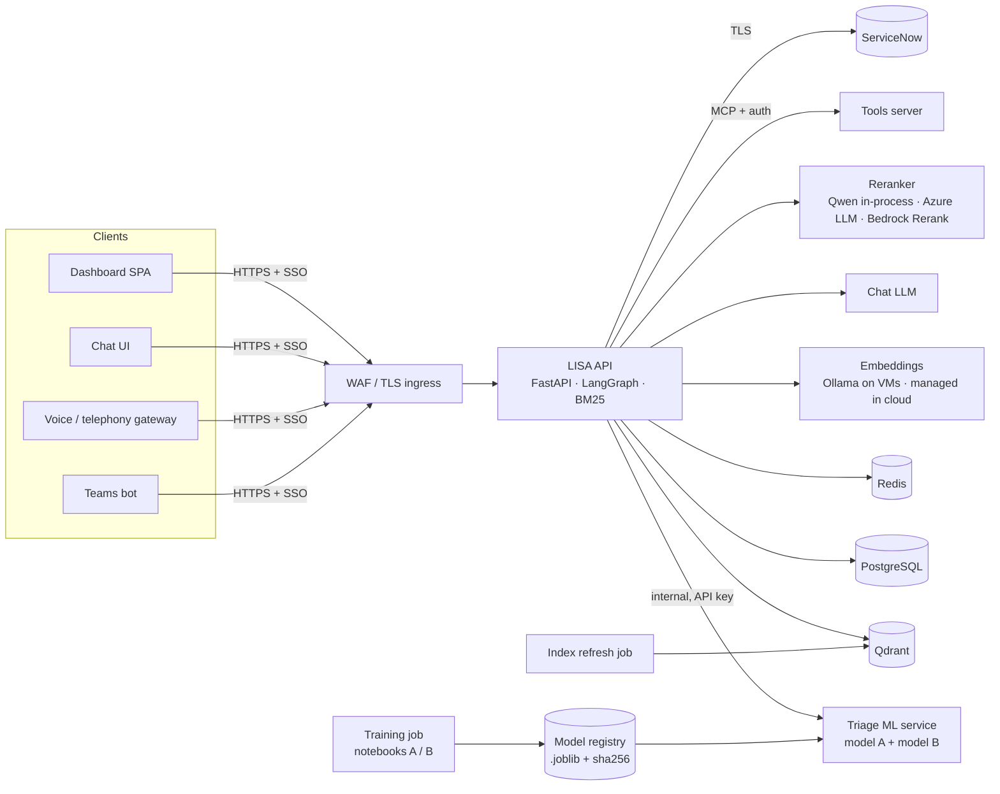

# LISA-Backend (hybrid) — Production Hosting Tech Stack (Local VMs / AWS / Azure)

This document is for running `LISA-Backend-playbooks-v2-hybrid` in production. It is based on a full
code read (see [`LISA-Backend-hybrid-blueprint.md`](LISA-Backend-hybrid-blueprint.md)). The column
order is the same throughout: **Local VMs | AWS | Azure**. **Ollama appears only in the Local VM
column.**

**What is new compared with the v2 hosting document:**
- A second deployable, the **triage ML service** (`models/`, scikit-learn + XGBoost, port 8300).
- The backend no longer needs scikit-learn for prediction.
- `RERANKER=azure` gives a reranker on Azure **without code changes**.
- The Qdrant collection-name clash is gone (the priority store was removed).

---

## 1. What the code does at runtime

### 1.1 Processes

| Process | What it holds | Notes from the code |
|---|---|---|
| **LISA API** (`dashboard_backend.main:app`) | LangGraph agent, REST API, BM25 indexes, the Qwen reranker (unless `RERANKER=azure`) | Runs every graph turn **synchronously inside the HTTP request**. Search services and the reranker load at import. `torch` is imported at start-up even with `RERANKER=azure` |
| **Triage ML service** (`models/app.py`) | Model A (CI SVM + urgency, 11 MB), model B (stacked ensemble with XGBoost, 162 MB) | FastAPI, both models load at start-up (~3–10 s). About 160 ms per ticket. Model B predicts one request at a time (`B_LOCK`, `n_jobs=1`). Binds `127.0.0.1`. Runs from **another project's Python environment** (`run_service.bat`) |
| Sibling services | tools-mcp (8100), Chat proxy (5174), Voice demo, Frontend (5173) | See section 3.4 |

### 1.2 State (unchanged from v2)

| State | Where | Production concern |
|---|---|---|
| Dashboard tables (9), incl. PII and full state JSON | `data/dashboard.sqlite` | One file; one process |
| LangGraph checkpoints (now also `ml_classification`) | `data/checkpoints.sqlite` | Stores reporter replies, including identity answers |
| Reset secrets, resume locks, LLM cache, ML back-off timer | Process memory | Lost on restart; not shared between replicas |

### 1.3 Connections

| Direction | System | Detail |
|---|---|---|
| Out | **Triage ML service** | `POST /predict` (one ticket, 5 s timeout, `X-API-Key`), up to **twice per ticket** (early look + real classification). On failure: CI blank, priority from triage, no further calls for 30 s |
| Out | ServiceNow | Basic auth, **`verify=False`**; reads now include `cmdb_ci` |
| Out | Chat LLM | `azure_llm` / `ollama` (URL hard-coded to `localhost`) / `claude_agent_sdk`. Agent mode needs `azure_llm` |
| Out | **Reranker** | Qwen in-process, or the **same Azure deployment** (`RERANKER=azure`): +1 LLM call per similar-incident search and per KB search |
| Out | Ollama `/api/embed` | `qwen3-embedding:0.6b` for every search |
| Out | Qdrant | `historical_incidents`, `knowledge_base_articles`; silent fallback to the embedded store; no API key option |
| Out | tools-mcp | MCP, no auth. Chrome / Edge clear deletes profile files **on the machine the tools server runs on** |
| In | Dashboard, Chat, Voice, Teams bot | No auth; CORS `localhost:5173` only |

---

## 2. Target production architecture

**Two deployables** (API and triage ML) behind one private network, plus shared data services.

---

## 3. Production tech stack

### 3.1 Compute and runtime

| Component | Local (Virtual Machines) | AWS | Azure |
|---|---|---|---|
| **OS / container runtime** | RHEL 9 / Ubuntu 24.04 VMs; Docker or Podman (k3s / RKE2 optional) | Amazon ECS on Fargate | Azure Container Apps (Dedicated workload profile), or AKS |
| **Images** (two) | `lisa-api` (Python 3.12, `uv sync --frozen`, CPU torch, artifacts + playbooks + reference JSON baked in) and `lisa-triage-ml` (Python 3.12, scikit-learn 1.9.1, XGBoost 3.4.1, FastAPI). Registry: Harbor / Artifactory | Same two images in Amazon ECR | Same two images in ACR |
| **LISA API** | 2+ VMs/containers behind the load balancer; 1 uvicorn worker per container | ECS service, 2+ tasks, 2 AZs, ALB | Container App, 2+ replicas, zone-redundant |
| **Triage ML service** | 2 containers on an internal VLAN; bind `0.0.0.0` inside the container, reachable only from the API; `TRIAGE_API_KEY` required | ECS service in private subnets (Service Connect), 2 tasks; or a **SageMaker real-time endpoint** with this image | Container App with **internal ingress only**, 2 replicas; or an **Azure ML managed online endpoint** with this image |
| **Long requests** | Proxy read timeout ≥ 300 s | ALB idle timeout ≥ 300 s | Container Apps ingress has a **240 s cap**: move graph turns to background jobs (S1) |
| **Async jobs** (recommended) | RabbitMQ / Redis Streams + workers | SQS + ECS workers | Service Bus + Container Apps workers (KEDA) |
| **Ingress / WAF / TLS** | F5 / HAProxy / Nginx + corporate CA | ALB + ACM + AWS WAF | Front Door Premium or Application Gateway WAF v2 |

### 3.2 AI models — Ollama on local VMs only

| Model role | Local (Virtual Machines) | AWS | Azure |
|---|---|---|---|
| **Chat LLM** | **Ollama** (pilot) / **vLLM** on GPU (production; needs code change M6) | **Amazon Bedrock** (Claude Sonnet / Amazon Nova) via `ChatBedrockConverse` (M6), or Azure OpenAI across clouds (works today) | **Azure OpenAI** `gpt-4o` behind APIM — **works today**, agent mode included |
| **Embeddings** | **Ollama** `qwen3-embedding:0.6b` (no change) | **Bedrock Titan Text Embeddings V2** (re-index; M12) | **Azure OpenAI `text-embedding-3-large`** (re-index; M12) |
| **Reranker** | **Qwen3-Reranker-0.6B** in-process (`RERANKER` unset) | **Bedrock Rerank** (Cohere Rerank 3.5 / Amazon Rerank) — a new client like `AzureRerankingClient` (M12); or `RERANKER=azure` across clouds | **`RERANKER=azure`** — the gpt-4o listwise reranker **already in the code**. Alternative: Cohere Rerank 3.5 on Azure AI Foundry (M12) |
| **CI, priority, group, category, subcategory, Major Incident alert** | Triage ML service container | Triage ML service on ECS, or a SageMaker endpoint | Triage ML service on Container Apps, or an Azure ML online endpoint |
| **Model training** (notebooks A / B on `raw_incident_reassign.csv`) | Scheduled job on a VM (cron / Airflow) → model registry (MLflow + MinIO) | SageMaker training job / Pipelines on a schedule → S3 + Model Registry | Azure ML pipeline on a schedule → Azure ML registry + Blob |
| **Model files** (`.joblib`, pickles) | MLflow / Artifactory, sha256 pinned | S3 (versioned) + sha256 | Blob (versioned) or Azure ML registry + sha256 |

**Notes on models:**
- **Reranker cut-offs:** they were tuned on Qwen (0.7 KB relevance and similar incidents, 0.85
  KB-confirmed CI, 85% lockout / Chrome rules). The Azure rubric was written so that 0.7 means
  "covers this problem". Confirm both rerankers agree on a labelled set before go-live.
- **Embedding change:** a new embedding model means re-indexing both Qdrant collections, and the KB
  query prefix must be fixed (it still adds a BGE prefix). See the v2 hosting document
  ([§3.2.3](../lisa-backend-hosting/LISA-Backend-hosting-techstack.md)) for the exact client interface.

### 3.3 Data

| Component | Local (Virtual Machines) | AWS | Azure |
|---|---|---|---|
| **Relational DB** (replaces both SQLite files; M1) | PostgreSQL 16 + standby (Patroni), pgBackRest | RDS PostgreSQL Multi-AZ | Azure Database for PostgreSQL Flexible Server, zone-redundant HA |
| **Redis** (reset secrets with TTL, resume locks, LLM cache, shared ML back-off; M2) | Redis Sentinel, TLS + ACL | ElastiCache (Valkey / Redis OSS) Multi-AZ | Azure Managed Redis |
| **Qdrant** (2 collections; M5) | Qdrant cluster on VMs, API key + TLS, snapshots | Qdrant on ECS / EC2 + EBS, or Qdrant Cloud | Qdrant on AKS / Container Apps + disk, or Qdrant Cloud |
| **Search artifacts** (BM25 `.joblib`) | Baked into the API image (versioned) | ECR image + S3 copy | ACR image + Blob copy |
| **Index refresh** (KB articles, closed incidents) | Scheduled job | ECS scheduled task | Container Apps Job |
| **Training data** (38k-ticket export) | Restricted file share, encrypted | S3 (SSE-KMS, restricted) | Blob / ADLS (CMK, restricted) |
| **Backups / DR** | pgBackRest + Qdrant snapshots + model registry backup | AWS Backup + cross-region | Azure Backup + geo-redundant |

### 3.4 Integrations and sibling services

| Component | Local (Virtual Machines) | AWS | Azure |
|---|---|---|---|
| **ServiceNow** (production instance) | Corporate proxy egress; OAuth 2.0 or a least-privilege user; TLS on (M3) | NAT Gateway + Elastic IP allow-listed | NAT Gateway + static IP allow-listed |
| **ServiceNow → Teams** (`u_followup_*` fields + Flow Designer) | Lives in ServiceNow | Same | Same |
| **Teams bot** | DMZ endpoint + Azure Bot Service registration | ECS + ALB + Azure Bot Service | App Service / Container Apps + Azure Bot Service |
| **Dashboard** (React 19 / Vite / HeroUI / Tailwind v4) | Nginx static | S3 + CloudFront | Static Web Apps |
| **Chat UI** (FastAPI + httpx proxy + HTML) | Container behind the proxy | ECS service, or fold its static page into CloudFront | Container Apps, or Static Web Apps |
| **Voice** — today a **local desktop demo** (faster-whisper, Silero VAD, soprano-tts, local mic / speaker; Ollama LLM by default). Production needs telephony | SIP / PBX gateway + faster-whisper on GPU + a TTS server; Ollama for its LLM | Amazon Connect / Chime SDK + Amazon Transcribe + Polly | Azure Communication Services (Call Automation, already referenced in `voice_intake.py`) + Azure AI Speech |
| **Tools server** (mock directory today) | Internal container; real AD / Entra ID integration; auth on MCP (M8) | ECS private service + auth | Container Apps internal + Microsoft Graph for Entra ID |
| **Browser clear** (deletes profile files **on the machine the tool runs on**) | Cannot work from a server: needs an agent **on the reporter's PC** (Intune / SCCM / endpoint agent) or stays `simulate` / `off` | Same | Same — Intune remediation scripts are the natural fit |

### 3.5 Security

| Component | Local (Virtual Machines) | AWS | Azure |
|---|---|---|---|
| **User sign-in** (none today; M4) | oauth2-proxy + Entra ID / AD FS | ALB OIDC with Entra ID | Built-in Entra ID auth |
| **API → triage ML** | Required `TRIAGE_API_KEY` from Vault, internal network only | Key from Secrets Manager; security group allows only the API | Key from Key Vault; internal ingress; or managed identity with an Entra-protected endpoint |
| **Secrets** | HashiCorp Vault | Secrets Manager | Key Vault + managed identity |
| **Network** | VLANs; ML, Qdrant, Ollama, Postgres, Redis, tools not user-reachable | Private subnets, security groups, VPC endpoints (incl. Bedrock) | VNet, Private Endpoints (incl. Azure OpenAI) |
| **Pickle safety** (`.joblib` runs code when loaded) | Only signed / sha256-pinned files from the registry; read-only mount | Same; S3 object lock | Same; immutable Blob versions |
| **PII** | Encrypted disks, retention job | KMS everywhere, retention job | CMK everywhere, retention job |

### 3.6 Operations

| Component | Local (Virtual Machines) | AWS | Azure |
|---|---|---|---|
| **Logs** | Loki / ELK | CloudWatch Logs | Log Analytics |
| **Metrics / traces** | OpenTelemetry → Prometheus / Grafana | CloudWatch + X-Ray | Application Insights |
| **Health / readiness** | API readiness = models + Qdrant + **ML `/health`** (M13); ML liveness `/health` | Same → target groups | Same → probes |
| **Model monitoring** (CI / priority drift, `status=error` rate, alert rate) | Grafana dashboards from `ml_classification` | CloudWatch / SageMaker Model Monitor | Azure ML monitoring / App Insights |
| **LLM tracing** | Self-hosted Langfuse | Langfuse / LangSmith | Langfuse / LangSmith |
| **CI/CD** | Two pipelines (api, triage-ml): ruff, 893 offline tests, image build + scan | GitHub Actions → ECR → ECS | GitHub Actions / Azure DevOps → ACR → Container Apps |
| **IaC** | Ansible + Terraform | Terraform / CDK | Terraform / Bicep |

---

## 4. Production sizing (starting points; load-test)

| Component | Local (Virtual Machines) | AWS | Azure |
|---|---|---|---|
| **LISA API** (min 2), Qwen reranker | 4 vCPU / 16 GB | Fargate 4 vCPU / 16 GB | D4 profile (4 / 16) |
| **LISA API** (min 2), `RERANKER=azure` | 2 vCPU / 8 GB (torch still imported) | Fargate 2 vCPU / 8 GB | 2 vCPU / 8 GB |
| **Triage ML service** (min 2) | 2 vCPU / 4 GB (model B = 162 MB file; measure RAM) | Fargate 2 vCPU / 4 GB, or `ml.m7i.large` | 2 vCPU / 4 GB, or `Standard_F2s_v2` endpoint |
| **Embeddings** | Ollama 2× (4 vCPU / 8 GB) | Bedrock Titan — no servers | Azure OpenAI — no servers |
| **PostgreSQL** | 2× (4 vCPU / 16 GB) | `db.m7g.xlarge` Multi-AZ | GP `D4ds_v5` HA |
| **Redis** | 3× (2 vCPU / 4 GB) | `cache.m7g.large` | Managed Redis B1+ |
| **Qdrant** | 3× (2 vCPU / 8 GB) | 3× `m7i.large` / Qdrant Cloud | 3× `D2s_v5` / Qdrant Cloud |
| **Chat LLM** | GPU servers for the model | Bedrock on-demand | Azure OpenAI Standard / PTU |

---

## 5. Code changes before production

**M1–M12 are the v2 list, updated for the hybrid copy. M13–M15 are new.**

| # | Change | Where |
|---|---|---|
| **M1** | SQLite → PostgreSQL (dashboard + checkpointer) | `incident_graph/db.py`, `workflows/common.py` |
| **M2** | In-memory state → Redis (reset secrets, resume locks, LLM cache, ML back-off) | `password_reset.py`, `routers/followup.py`, `workflows/common.py`, `ml_triage.py` |
| **M3** | ServiceNow TLS on, production instance, least privilege | `servicenow_client.py` (`verify=False`), `dashboard_backend/main.py` |
| **M4** | Authentication on every API route; the reviewer comes from the signed-in user | `dashboard_backend/main.py`, `routers/human_review.py` |
| **M5** | Qdrant: fail fast (no embedded fallback), API key + TLS. The collection clash is fixed by the priority store's removal | `resolution_engine/*/vector_search_store.py` |
| **M6** | LLM providers: configurable Ollama URL, vLLM / Bedrock providers, agent mode for any tool-calling model; drop `claude_agent_sdk` in production | `workflows/common.py`, `agentic/agent.py` |
| **M7** | Dependencies: declare `mcp`, `pyyaml` and `python-dotenv` directly; remove the missing workspace member; **move scikit-learn and the unused libraries out of the API's runtime dependencies** (into a `research` group — nothing deleted) | `pyproject.toml` |
| **M8** | Tools server: auth, real directory; browser clear `simulate` / `off` until an endpoint agent exists | `tools_client.py`, `browser_fix.py`, LISA-tools-mcp |
| **M9** | Remove hard-coded CORS origins and queue assignee | `main.py`, `routers/servicenow_queue.py` |
| **M10** | Ship runtime data (`cmdb_ci_app_clean.json`, playbooks, CMDB mock), set `CMDB_LOOKUP=live` | Image build |
| **M11** | Decide the Teams reply path (register or retire `teams_webhook.py`) | `main.py` |
| **M12** | Pluggable embeddings and rerankers per environment (Bedrock Rerank client modelled on `AzureRerankingClient`); fix the KB query prefix; re-index; recalibrate cut-offs | `resolution_engine/*`, `azure_reranking_client.py` |
| **M13** | **Triage ML service productionised:** • its own `pyproject.toml` / lock (scikit-learn 1.9.1, XGBoost 3.4.1), not `--project C:/PROD/...` • a Dockerfile; bind `0.0.0.0` in the container • `TRIAGE_API_KEY` **required** • model files from the registry with pinned sha256 • add its `/health` to the API readiness and the dashboard status | `models/` |
| **M14** | **Version-control the service**: `.gitignore` excludes `models/` (and `*.joblib`), so `app.py`, `model_a.py`, `model_b.py` and the docs are not committed. Ignore only the model binaries | `.gitignore` |
| **M15** | **Alert on ML degradation.** `status: error` silently blanks the CI and falls back to the triage priority; count it and alert | `ml_triage.py`, `classification_agent.py` |
| **S1** | Graph turns as background jobs (queue + worker) | Routers calling `app.invoke` |
| **S2** | PII retention / redaction (`incident_json`, `trace_steps`, checkpoints, `reporter_profiles`) | `db.py` |
| **S3** | Structured logging instead of `print()` | Throughout |
| **S4** | Readiness endpoint; load models before ready | `ollama_health.py` |
| **S5** | Index refresh + model retraining pipelines with versioned artifacts | New jobs |
| **S6** | Import `torch` lazily (only when Qwen is selected) so `RERANKER=azure` images can drop torch | `*/qwen_reranking_client.py` |
| **S7** | Paginate `/api/resolution-engine` and stop writing on reads | `routers/resolution_engine.py` |
| **S8** | Make the early look reuse its ML result when the text has not changed (today up to 2 calls per ticket) | `classify_first.py`, `classification_agent.py` |
| **S9** | Generate `model_a.py` / `model_b.py` in the training pipeline, with a check that they match the model's notebook version | `models/build_model_modules.py` |

---

## 6. Which environment to pick

| If… | Pick | Notes |
|---|---|---|
| Azure OpenAI, Teams, Entra ID and ACS are already in use (as this code assumes) | **Azure** (recommended) | `RERANKER=azure` and agent mode work today. The triage ML service fits Container Apps (internal) or an Azure ML endpoint. Do M1–M15; plan S1 for the 240 s cap |
| Data must stay on-premises | **Local VMs** | Ollama for embeddings (and chat for a pilot), vLLM on GPU for production chat, Qwen reranker in-process, triage ML in a container. Teams still needs an Azure Bot registration |
| AWS is mandated | **AWS** | Bedrock chat + Titan embeddings + Bedrock Rerank (M6, M12); triage ML on ECS or SageMaker. Teams / ACS remain Azure dependencies |
