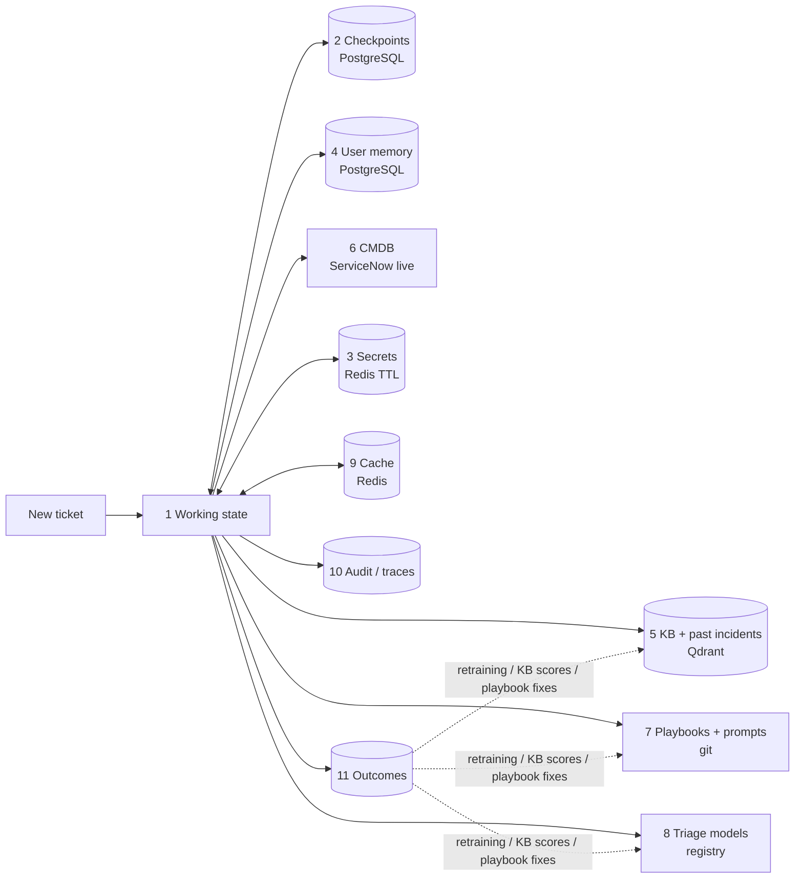

# LISA — Memory architecture (what to use for each kind of memory)

This is based on the LISA code (hybrid / PROD copy): what each kind of memory is today, and what
suits production.

**Rule of thumb for this project:** every memory is either **per ticket** (dies with the ticket),
**per reporter** (follows a person across tickets) or **organisational** (shared by everyone).
Keep the three apart. They have different owners, lifetimes and privacy rules.

---

## 1. The memory map

| # | Memory type | What it holds in LISA | Today (POC) | Production choice | Lifetime |
|---|---|---|---|---|---|
| 1 | **Working memory** (within one step) | The graph state for the current node: incident text, triage, classification, KB results, draft | `IncidentAgentState` in the process | Same, no change | One graph turn |
| 2 | **Short-term / conversation memory** (one ticket, across turns) | Every question, answer, interrupt and state version of one incident. A ticket can pause for hours or days | LangGraph checkpointer → `data/checkpoints.sqlite` | **LangGraph `PostgresSaver`** on the production PostgreSQL | Until the ticket closes + a retention period (e.g. 30–90 days), then purge |
| 3 | **Secret / ephemeral memory** | Identity-check answers, the reset session token, the temporary password | Process memory, 15-minute TTL (`password_reset.py`) | **Redis** with a 15-minute TTL, encrypted values, a key per thread. Never in checkpoints, logs or the DB | ≤ 15 minutes |
| 4 | **User memory** (per reporter, across tickets) | Phone, location, apps used, most frequent CI, last 5 issue summaries | `reporter_profiles` + `reporter_incident_history` in `dashboard.sqlite`, keyed by email / staff number | **PostgreSQL tables** (same schema) **plus source + timestamp per fact**, refreshed from ServiceNow each ticket (§3) | Facts re-confirmed after N days; history per retention policy; deletable on request |
| 5 | **Long-term knowledge** (organisational, semantic) | KB articles (`knowledge_base_articles`) and past incidents (`historical_incidents`), each as vectors + BM25 | Frozen artifacts: Qdrant + `.joblib`; no refresh | **Qdrant server** (+ BM25), **refreshed by a scheduled job** from ServiceNow, each article carrying its ServiceNow version (staleness flag) | Until ServiceNow changes it |
| 6 | **Entity / relationship memory** | Servers, applications, CIs and how they relate | Mock server list (`CMDB_LOOKUP=mock`) | **ServiceNow CMDB, queried live** (`cmdb_ci`, `cmdb_rel_ci`) — the source of truth, no copy | Always current |
| 7 | **Procedural memory** (how LISA behaves) | Playbooks (markdown rules and questions), prompts (`shared_guidance.py`), code rules (`CODE_RULES.md`) | Files in the repo; playbooks re-read on every call | **Git**, versioned and reviewed; deployed with the image (or `PLAYBOOKS_DIR` from a config store) | Per release |
| 8 | **Learned memory** (trained models) | Triage ML models A and B (CI, priority, group, category); the reranker weights | `.joblib` files next to the service | **Model registry** (MLflow / SageMaker / Azure ML) with sha256 pinning | Per model version |
| 9 | **Cache memory** | LLM responses, the tool-schema list, the ML-service back-off | Process memory (or `llm_cache.sqlite`) | **Redis** (shared by all replicas), short TTL | Minutes to hours |
| 10 | **Operational / audit memory** | Status per ticket, token usage, trace steps, full state JSON, ServiceNow sync errors | `dashboard.sqlite` (9 tables) | **PostgreSQL** + logs / traces (OpenTelemetry, Langfuse); PII redacted in traces | Audit policy (e.g. 1 year); full state JSON shorter |
| 11 | **Feedback / outcome memory** (learning from results) | — **missing today** | — | **New `outcomes` table** (§4): what was predicted vs what was final, which KB was used, whether the reporter confirmed it fixed | Long-term (training data) |

---

## 2. How they fit together on one ticket

---

## 3. User memory — the one to treat carefully

**Today:**
- `extract_incident_context` writes the profile and reads it back.
- The prompts show it as *known* context (`completeness_agent._render_known_context`,
  `_render_reporter_history`).
- Values are overwritten as "latest known".
- There is no source, no age and no confidence.

**For production** (the "self-correcting memory" idea, applied small):

| Field | Store with it | Rule |
|---|---|---|
| `mobile_phone`, `location`, `checkout_location` | `source` (`servicenow_profile` / `reporter_answer` / `ticket_text`), `observed_at` | ServiceNow profile values are refreshed every ticket. Other sources older than N days (e.g. 90) are **"to confirm"**, not "known": LISA asks, it does not assume |
| `applications_used`, `most_frequent_ci` | `observed_at` per entry | A hint for questions only; never decides the CI |
| `past_issue_summaries` | `incident_id`, `created_at` | These are LLM-written summaries: show them as history, not as facts about the current ticket |

**Also:**
- Key users by **staff number** (stable), with email as a fallback. The code already does this.
- Add a **"forget this reporter"** action (delete their profile and history rows) for privacy
  requests.
- **Never** store identity-check answers, passwords or tokens in user memory (they belong in
  memory type 3 only).

---

## 4. The missing piece: outcome memory

LISA already **produces** the signals, but throws them away after the ticket:

| Signal | Where it appears today |
|---|---|
| ML CI vs final CI (after overrides, or `kb_confirmed`) | `ml_classification.applied`, `classification.ci_decision_source` |
| ML priority vs final priority (after policy / re-check) | `ml_classification`, `priority_policy_reason` |
| Which KB article was given, and whether the reporter said it fixed it | `search_results`, `user_confirmed_resolved` |
| Resolved by LISA / escalated / human-reviewed, and why | `incidents.status`, `rejection_reason` |
| Questions asked vs answered | Checkpoints |

**Add one table** (`outcomes`: one row per closed ticket, no free text, no PII) and use it for:
1. **Retraining** the triage models on corrected labels (final CI / priority). This closes the
   loop the ML service lacks today.
2. **KB effectiveness:** articles that often get "no, not fixed" are flagged for review or ranked
   lower.
3. **Playbook tuning:** questions that are often answered "don't know", or skipped, are candidates
   to drop.
4. **Dashboards:** automation rate, CI accuracy and KB fix rate over time.

---

## 5. What not to use (for now)

| Option | Why not |
|---|---|
| A general agent-memory framework (mem0, Zep, cognee, LangGraph `Store` for everything) | LISA's memories are well defined and already have homes. A framework adds a store, LLM extraction costs and a PII copy without solving a current problem |
| LLM-written "memories" about users | They can be wrong or stale and are hard to audit or delete. Keep user memory as **facts with a source** |
| The vector DB as user memory | Exact facts (phone, location) belong in relational tables; vectors are for similarity search |
| Long chat history in every prompt | The checkpoint already holds the conversation; the prompts take only the structured facts they need (as the code does today) |

**Optional later:** LangGraph's **`PostgresStore`** (cross-thread memory with namespaces) could hold
user memory instead of custom tables. It only helps if you move to agent mode broadly; the
dashboard queries the current tables directly, so keep the tables for now.

---

## 6. Production stores per environment

| Memory | Local VMs | AWS | Azure |
|---|---|---|---|
| 2, 4, 10, 11 (relational) | PostgreSQL 16 (+ standby) | RDS PostgreSQL Multi-AZ | Azure Database for PostgreSQL Flexible Server |
| 3, 9 (TTL / cache) | Redis (Sentinel) | ElastiCache (Valkey / Redis OSS) | Azure Managed Redis |
| 5 (vectors + BM25) | Qdrant cluster | Qdrant on ECS / EC2 or Qdrant Cloud | Qdrant on AKS / Container Apps or Qdrant Cloud |
| 6 (entities) | ServiceNow CMDB (live) | Same | Same |
| 7 (rules) | Git + image | Git + image (ECR) | Git + image (ACR) |
| 8 (models) | MLflow + MinIO | SageMaker Model Registry + S3 | Azure ML registry + Blob |
| 10 traces | Langfuse (self-hosted) | Langfuse / CloudWatch | Langfuse / Application Insights |

---

## 7. Code changes this needs

| Change | Where |
|---|---|
| `SqliteSaver` → `PostgresSaver` | `workflows/common.py:make_checkpointer` |
| Dashboard and user tables → PostgreSQL; add `source` / `observed_at` columns | `incident_graph/db.py` |
| "To confirm" rendering for old or non-ServiceNow facts | `completeness_agent._render_known_context`, `context_extraction_agent.py` |
| Secret slots → Redis with TTL + encryption | `password_reset.py` |
| LLM cache, resume locks, ML back-off → Redis | `workflows/common.py`, `routers/followup.py`, `ml_triage.py` |
| KB version in the Qdrant payload + staleness check; refresh job | `resolution_engine/kb_retrieval/*`, new job |
| `outcomes` table, written in `resolve_incident` / `auto_escalate_incident` / `human_review` | `db.py`, `workflows/core_nodes.py` |
| Retention / purge jobs (checkpoints, `incident_json`, `trace_steps`, profiles) | New scheduled job |
| `CMDB_LOOKUP=live` | `.env` / settings |
