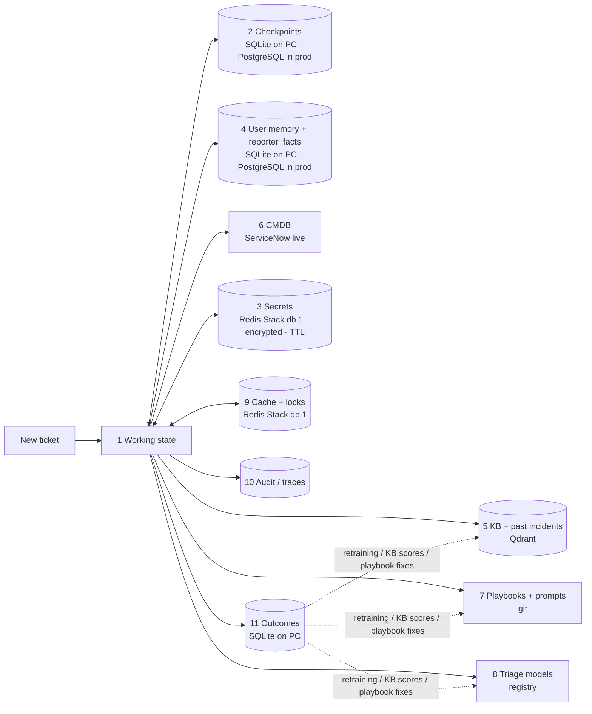

# LISA — Memory architecture (what to use for each kind of memory)

This doc is based on the LISA code (hybrid / PROD copy). For each kind of memory it says three things: what it was in the POC, what it is now on a PC running the
**memory & cache update pack with Redis Stack in Docker**, and what suits production.

**Rule of thumb for this project:** every memory is either **per ticket** (dies with the ticket),
**per reporter** (follows a person across tickets) or **organisational** (shared by everyone).
Keep the three apart. They have different owners, lifetimes and privacy rules.

> **Your setup (local PC).** The update pack is installed (`MEMORY_AND_CACHE.md`), and Redis Stack runs in Docker:
> `docker run -d --name redis-stack -p 6379:6379 -p 8001:8001 redis/redis-stack:latest`.
> - **LISA uses Redis database 1:** `REDIS_URL=redis://localhost:6379/1`.
> - **Database 0 is kept for vector / semantic-cache work:** the RedisVL notebook. Redis Stack can only build search indexes in database 0.
> - **Checkpoints, user memory and outcomes stay in SQLite** (`data/`). Redis keeps data in RAM and saves only periodic snapshots, so it is not the place for records you must keep.
> - Setup steps are in [`LISA-memory-integration-guide.md`](LISA-memory-integration-guide.md), step 0.

> **Which LISA version?** Written against the **hybrid PROD copy** (`LISA-Backend-playbooks-v2-hybrid-PROD`). Its code is identical to `-hybrid`, so it applies
> there unchanged. It **also applies to v2** (`LISA-Backend-playbooks-v2`): the files it changes are identical in v2, apart from the following.
> - v2 has no triage ML service, so memory type 8 means v2's in-process CI / priority `.joblib` classifiers.
> - The `outcomes` columns come from v2's `classification` (`ci_decision_source` = classifier / retrieval / both / conflict) instead of `ml_classification`.
> - The update pack itself was built and tested on the hybrid PROD copy.

---

## 1. The memory map

| # | Memory type | What it holds in LISA | POC (before) | **Now on your PC** (update pack + Redis Stack) | Production choice | Lifetime |
|---|---|---|---|---|---|---|
| 1 | **Working memory** (within one step) | The graph state for the current node: incident text, triage, classification, KB results, draft | `IncidentAgentState` in the process | Same | Same, no change | One graph turn |
| 2 | **Short-term / conversation memory** (one ticket, across turns) | Every question, answer, interrupt and state version of one incident. A ticket can pause for hours or days | `data/checkpoints.sqlite` | **Still `data/checkpoints.sqlite`.** PostgreSQL is ready (`DATABASE_URL`) but not needed on one PC | **LangGraph `PostgresSaver`** on the production PostgreSQL | Until the ticket closes + a retention period (e.g. 30–90 days), then purge |
| 3 | **Secret / ephemeral memory** | Identity-check answers, the reset session token, the temporary password | Process memory, 15-minute TTL | **Redis Stack, db 1, key `lisa:reset:<thread>`, Fernet-encrypted, 15-minute TTL** (needs `SECRET_SLOT_KEY`; without it they stay in process memory, never unencrypted) | Redis, encrypted, TTL; in a Redis that never evicts (§6) | ≤ 15 minutes |
| 4 | **User memory** (per reporter, across tickets) | Phone, location, apps used, most frequent CI, last 5 issue summaries | `reporter_profiles` + `reporter_incident_history` in `dashboard.sqlite` | **Same tables, plus `reporter_facts`**: the number the reporter confirmed / corrected / gave, with source and date (§3) | PostgreSQL tables (same schema) | Facts offered for 90 days (`MEMORY_FACT_MAX_AGE_DAYS`); deletable on request |
| 5 | **Long-term knowledge** (organisational, semantic) | KB articles and past incidents, each as vectors + BM25 | Qdrant + `.joblib`, frozen | Same (Qdrant). Redis Stack's vector search is **not** a replacement (§5) | **Qdrant server** (+ BM25), refreshed by a scheduled job, with a staleness flag | Until ServiceNow changes it |
| 6 | **Entity / relationship memory** | Servers, applications, CIs and how they relate | Mock server list (`CMDB_LOOKUP=mock`) | Same; with `CMDB_LOOKUP=live` each answer is cached for 1 hour in Redis | **ServiceNow CMDB, queried live** — no copy | Always current |
| 7 | **Procedural memory** (how LISA behaves) | Playbooks, prompts (`shared_guidance.py`), code rules | Files in the repo | Same | **Git**, versioned and reviewed; deployed with the image | Per release |
| 8 | **Learned memory** (trained models) | Triage ML models A and B; the reranker weights | `.joblib` files | Same; results cached 10 minutes in Redis (`ok` results only) | **Model registry** (MLflow / SageMaker / Azure ML) with sha256 pinning | Per model version |
| 9 | **Cache memory** | LLM responses, embeddings, reranker scores, ML results, ServiceNow reads, health checks, ML back-off, resume locks | Process memory (or `llm_cache.sqlite`) | **Redis Stack, db 1** — shared by every backend process and kept across backend restarts (see the caching plan) | Redis (shared by all replicas), short TTLs, LRU eviction | Seconds to a day |
| 10 | **Operational / audit memory** | Status per ticket, token usage (now also `cached_input_tokens`), trace steps, full state JSON | `dashboard.sqlite` | Same | **PostgreSQL** + logs / traces (OpenTelemetry, Langfuse); PII redacted | Audit policy (e.g. 1 year); full state JSON shorter |
| 11 | **Feedback / outcome memory** | ML vs final CI / priority, KB given, "did it fix it", how the ticket ended | — missing | **`outcomes` table** in `dashboard.sqlite`, one row per closed ticket; `GET /api/insights/outcomes` (§4) | PostgreSQL | Long-term (training data) |
| 12 | **Semantic cache** (vector similarity) — experimental | Stored answers to generic how-to questions | — | **Only in the notebook** (`LISA_semantic_cache_redisvl.ipynb`), Redis Stack **db 0**. Not wired into LISA | Not planned for ticket answers (caching plan §4) | TTL (e.g. 1 day) |

---

## 2. How they fit together on one ticket

**What lives where on your PC:**

| Store | What | Survives a backend restart? | Survives `docker rm redis-stack`? |
|---|---|---|---|
| `data/checkpoints.sqlite` | 2 | Yes | Yes |
| `data/dashboard.sqlite` | 4, 10, 11 | Yes | Yes |
| Redis Stack db 1 | 3, 9 | Yes | Only with a volume (`-v lisa-redis:/data`, integration guide step 0) |
| Redis Stack db 0 | 12 (notebook only) | Yes | Only with a volume |

**If Redis is not running:** LISA carries on, more slowly. This was tested by pointing LISA at a stopped Redis.
- Every Redis call waits up to 2 seconds before giving up.
- Every cache logs one warning and works without the cache. The LLM cache also logs "Redis lookup failed" and calls the model.
- The resume lock falls back to the in-process lock.
- Only a password reset that is in progress at that moment fails, and it can be restarted.

Start Docker Desktop before LISA. Step 0 of the integration guide makes the container start automatically with Docker.

---

## 3. User memory — the one to treat carefully

**What the update pack does** (`incident_graph/memory.py`, `db.reporter_facts`):

| Moment | Code | What happens |
|---|---|---|
| Ticket closes (`resolve_incident`, `auto_escalate_incident`, `human_review` reject) | `memory.remember_from_ticket` | If the reporter **confirmed, corrected or gave** their number in this ticket, it is saved with its source (`reporter_confirmed` / `reporter_corrected` / `reporter_provided`), the date and the incident ID |
| Next ticket starts (`extract_incident_context`) | `memory.recall_contact` | The remembered number is **offered for confirmation** ("Is your contact number X still correct?") only when: (a) ServiceNow has no number, or (b) the reporter **corrected** or **gave** a number that differs from ServiceNow, within 90 days. Otherwise ServiceNow's number is used, as before |
| Always | — | The number is **never assumed**: the existing confirm question still runs. `extracted_context.reporter_mobile_phone_source` records where it came from |

**Stored in SQLite, not Redis,** on purpose:
- it must not expire or be evicted;
- it must be deletable on request;
- it must be queryable.

**Rules:**

| Fact | Stored with it | Rule |
|---|---|---|
| Mobile phone | `source`, `observed_at`, `incident_id` | ServiceNow wins unless the reporter corrected it. Offered, never assumed. `REMEMBER_CONTACT=0` turns this off |
| Location | — | **Not remembered.** Staff move between gates and buildings daily, and LISA always asks |
| `applications_used`, `most_frequent_ci` | (existing profile) | A hint only; never decides the CI |
| `past_issue_summaries` | `incident_id`, `created_at` | History, not facts about the current ticket (as before) |

**Privacy:**
- **Delete everything about one reporter:** `uv run python -m incident_graph.memory forget <email or staff number>` deletes their profile, history and facts.
- **Never** store identity-check answers, passwords or tokens in user memory. They exist only in memory type 3 (encrypted in Redis, 15 minutes).

---

## 4. Outcome memory (now recorded)

One `outcomes` row per closed ticket, with no free text and no personal data. It is written by the same three closing nodes and by `escalate_to_security`.
It is idempotent: a node that runs again just rewrites its row.

| Column group | From |
|---|---|
| `ml_ci`, `ml_ci_conf`, `final_ci`, `ci_source` | `ml_classification`, `classification.ci_decision_source` |
| `ml_priority`, `final_priority`, `policy_reason` | `ml_classification`, `classification` |
| `kb_top`, `kb_top_relevance`, `reporter_confirmed` | The top KB result, `user_confirmed_resolved` |
| `final_status` | `resolved` / `rejected` / `security_escalated` |
| `workflow_mode`, `reranker`, `llm_model`, `ml_model_files`, `total_tokens` | Settings, the model record and `token_usage` |

**Read it** at `GET http://127.0.0.1:8000/api/insights/outcomes`, which returns:
- the resolved %;
- ML-vs-final CI and priority agreement;
- the ML error rate;
- tokens per ticket;
- the KB articles with the lowest "it fixed it" rate.

**Use it for:**
1. **Retraining** the triage models on corrected labels (final CI / priority).
2. **KB effectiveness:** articles that often get "no, not fixed" go to the KB owners.
3. **Playbook tuning.**
4. **Dashboards:** automation rate, CI accuracy and KB fix rate over time.

---

## 5. What not to use (for now)

| Option | Why not |
|---|---|
| **Redis (even Redis Stack) as the store for user memory, outcomes or checkpoints** | Redis keeps data in RAM and, by default, saves a snapshot only every few minutes (`save 3600 1 300 100 60 10000`, no AOF). These records must not be lost, evicted or expire, and you query them with SQL. Redis is for TTL data: secrets, caches and locks |
| **Redis Stack vector search instead of Qdrant** | KB articles and past incidents are already indexed in Qdrant, with BM25 next to them. Two vector stores would mean two indexes to keep in sync. Use Redis Stack's vectors only for cache-like experiments (the semantic-cache notebook) |
| **A semantic cache for ticket answers** | Similar wording does not mean the same answer: another device, another CI, another reporter. See caching plan §4 and notebook Part 2 |
| A general agent-memory framework (mem0, Zep, cognee, LangGraph `Store` for everything) | LISA's memories are well defined and already have homes. A framework adds a store, LLM extraction costs and a PII copy |
| LLM-written "memories" about users | They can be wrong or stale and are hard to audit or delete. Keep user memory as **facts with a source** |
| Long chat history in every prompt | The checkpoint already holds the conversation; prompts take only the structured facts they need |

**Optional later:**
- **Redis checkpoints:** Redis Stack can also hold LangGraph checkpoints (`langgraph-checkpoint-redis` needs RedisJSON + Search, which Stack has). That is not wired in. On one PC SQLite is simpler, and in production PostgreSQL is more durable.
- **`PostgresStore`:** LangGraph's `PostgresStore` (cross-thread memory) only helps if agent mode becomes the main mode.

---

## 6. Stores per environment

| Memory | **Your PC (now)** | Local VMs | AWS | Azure |
|---|---|---|---|---|
| 2, 4, 10, 11 (relational) | SQLite in `data/` | PostgreSQL 16 (+ standby) | RDS PostgreSQL Multi-AZ | Azure Database for PostgreSQL Flexible Server |
| 3 (secrets, TTL) | Redis Stack db 1 (Docker) | Redis with **`noeviction`** (a separate instance from the cache) | ElastiCache (Valkey / Redis OSS) | Azure Managed Redis |
| 9 (cache, locks) | Redis Stack db 1 (Docker) | Redis (Sentinel), `allkeys-lru` | ElastiCache (Valkey / Redis OSS) | Azure Managed Redis |
| 12 (semantic cache experiments) | Redis Stack db 0 | Redis Stack / Redis 8 | A Redis service with vector search (check the service supports it) | Azure Managed Redis with the search module |
| 5 (vectors + BM25) | Qdrant (local) | Qdrant cluster | Qdrant on ECS / EC2 or Qdrant Cloud | Qdrant on AKS / Container Apps or Qdrant Cloud |
| 6 (entities) | ServiceNow CMDB (mock / live) | ServiceNow CMDB (live) | Same | Same |
| 7 (rules) | Files in the project | Git + image | Git + image (ECR) | Git + image (ACR) |
| 8 (models) | `.joblib` in `models/` | MLflow + MinIO | SageMaker Model Registry + S3 | Azure ML registry + Blob |
| 10 traces | `dashboard.sqlite` | Langfuse (self-hosted) | Langfuse / CloudWatch | Langfuse / Application Insights |

**Eviction is set per Redis instance, not per database.** On your PC one instance is fine. It runs with `noeviction` and no memory limit, and LISA's small data will not fill it.
In production, put secrets (3) and cache (9) in **separate instances**, so the cache's LRU eviction can never delete a reset secret.

---

## 7. Code changes — status

| Change | Where | Status |
|---|---|---|
| `SqliteSaver` → `PostgresSaver` when `DATABASE_URL` is set | `workflows/common.py:make_checkpointer` | **Done** (off on your PC) |
| `reporter_facts`, `outcomes`, `token_usage.cached_input_tokens` | `incident_graph/db.py` | **Done** |
| Save confirmed / corrected phone at ticket close; offer it for confirmation | `memory.py`, `core_nodes.py`, `context_extraction_agent.py` | **Done** |
| Secret slots → Redis with TTL + encryption | `password_reset.py` | **Done** (on with `REDIS_URL` + `SECRET_SLOT_KEY`) |
| LLM cache, resume lock, ML back-off → Redis | `workflows/common.py`, `routers/followup.py`, `ml_triage.py` | **Done**. The resume lock covers the Follow-up tab only; `servicenow_queue.continue_followup` and `voice_intake` are not covered yet |
| `outcomes` written at close; `/api/insights/outcomes` | `memory.py`, `core_nodes.py`, `triage_agent.py`, `routers/insights.py` | **Done** |
| Retention / purge, forget a reporter | `python -m incident_graph.memory purge / forget` | **Done** (a command; schedule it yourself) |
| Dashboard and user tables → PostgreSQL | `db.py` | Not yet (SQLite only) |
| KB version in the Qdrant payload + staleness check; refresh job | `resolution_engine/kb_retrieval/*`, new job | Not yet |
| `CMDB_LOOKUP=live` | `.env` | Setting only (cached 1 h) |
