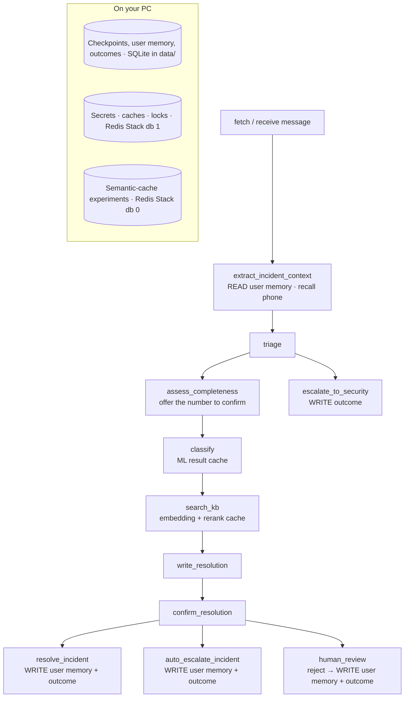

# Integrating the memory architecture into LISA — step-by-step guide (Redis Stack on your PC)

This guide puts [`LISA-memory-architecture.md`](LISA-memory-architecture.md) into the LISA code (hybrid / PROD copy).
Most steps are **already implemented in the memory & cache update pack** (`LISA-memory-cache-update.zip`, explained in `MEMORY_AND_CACHE.md`).
This guide now says how to **switch them on with the Redis Stack you run in Docker**, how to check each one works, and what is still open.

**Rules for every step:**
- It keeps working **without** the new infrastructure. With `REDIS_URL` / `DATABASE_URL` unset, LISA uses SQLite and process memory as before, and the test suite runs unchanged.
- It does not change graph node names, interrupt texts or state keys.

| Step | Memory type | What it does | Status | Needs Redis Stack? |
|---|---|---|---|---|
| 0 | — | Your Redis Stack: databases, persistence, auto-start | **Do once** | — |
| 1 | Settings | Point LISA at Redis | **Do once** | Yes |
| 2 | Short-term (per ticket) | Checkpoints: SQLite (PC) / PostgreSQL (production) | Done; stays SQLite on your PC | No |
| 3 | Secrets (15 min) | Reset secrets in Redis, encrypted, TTL | Done | Yes |
| 4 | Cache + locks | LLM cache, caches, resume lock, ML back-off in Redis | Done (resume lock: Follow-up tab only) | Yes |
| 5 | User memory | Remember the confirmed / corrected phone number, with source and date; forget a reporter | Done | No (SQLite) |
| 6 | Outcome memory | `outcomes` table + `/api/insights/outcomes` | Done | No (SQLite) |
| 7 | Long-term knowledge | KB version in the index, staleness check, refresh job | **Not yet** | No |
| 8 | Retention | Purge command for old checkpoints, traces and profiles | Done (a command; schedule it) | No |
| 9 | Relationships | `CMDB_LOOKUP=live` (cached 1 h) | Setting only | Optional |

> **Which LISA version?** Written against the **hybrid PROD copy** (`LISA-Backend-playbooks-v2-hybrid-PROD`), where the update pack was built and tested.
> It also applies to `-hybrid` unchanged. For **v2** (`LISA-Backend-playbooks-v2`):
> - skip the ML back-off and ML cache (v2 has no `ml_triage.py`);
> - fill the `ml_*` outcome columns from v2's `classification`;
> - fix v2's Qdrant name clash (priority vs CI `historical_incidents`) before step 7.

---

## Step 0 — Your Redis Stack (do once)

You started it with:

```powershell
docker run -d --name redis-stack -p 6379:6379 -p 8001:8001 redis/redis-stack:latest
```

### 0.1 Which database is for what

| Redis database | Used by | Why separate |
|---|---|---|
| **db 0** | The semantic-cache notebook (RedisVL), RedisInsight's default view | Redis Stack can build search / vector indexes **only in db 0**. Tested: `FT.CREATE` on db 1 fails with "Cannot create index on db != 0" |
| **db 1** | **LISA**: secrets, caches, locks, LLM cache | LangChain's LLM cache writes keys **without** a `lisa:` prefix, and its `clear()` empties the whole database. Its own database keeps it away from your notebook data |

### 0.2 Recommended: keep data and start automatically (optional, one-time)

Your container works as it is. Its defaults (checked):
- no memory limit, and `noeviction`;
- a snapshot to `/data` every few minutes;
- data survives `docker stop` / `docker start` and PC restarts, but **not** `docker rm`.

To keep the data even if the container is deleted, and to start it whenever Docker Desktop starts, re-create it once. This deletes the current cache contents, which is harmless:

```powershell
docker rm -f redis-stack
docker run -d --name redis-stack --restart unless-stopped -p 6379:6379 -p 8001:8001 -v lisa-redis:/data redis/redis-stack:latest
```

### 0.3 Check it

```powershell
docker exec redis-stack redis-cli PING                 # PONG
docker exec redis-stack redis-cli MODULE LIST          # includes "search" (needed for the notebook only)
```

You don't need a memory limit or an eviction policy on your PC: LISA's data is a few MB. Production is different; see the architecture doc §6.

---

## Step 1 — Settings (do once)

1. **Make the encryption key** for the reset secrets, in the LISA folder:

   ```powershell
   uv run python -c "from cryptography.fernet import Fernet; print(Fernet.generate_key().decode())"
   ```

2. **Add to `.env`:**

   ```dotenv
   REDIS_URL=redis://localhost:6379/1      # db 1 = LISA (db 0 is for vector / notebook work)
   SECRET_SLOT_KEY=<the key from above>    # without it, reset secrets stay in process memory (never unencrypted in Redis)
   LLM_CACHE_BACKEND=redis                 # the exact LLM answer cache in Redis too (optional)
   # LLM_CACHE_TTL_SECONDS=86400
   ```

   Keep `SECRET_SLOT_KEY` out of git and the chat. If you change it, any reset in progress is lost; nothing else is affected.

3. **Run the backend with the `redis` package added for the run.** This doesn't change `pyproject.toml`:

   ```powershell
   uv run --with redis uvicorn dashboard_backend.main:app --reload --port 8000
   ```

   If `REDIS_URL` is set and the `redis` package is missing, you get an error that says what to install. It comes at startup with `LLM_CACHE_BACKEND=redis`, otherwise on the first request that uses Redis. That is deliberate: a setting that silently did nothing would be worse.

4. **Check it worked.** `http://127.0.0.1:8000/api/insights/cache` should say `"backend": "redis"`.

How the code reaches Redis: `incident_graph/infra.py` → `redis_client()` creates one client per process, with 2-second timeouts. It returns `None` when `REDIS_URL` is unset.

---

## Step 2 — Short-term memory: checkpoints

**On your PC:** stays in `data/checkpoints.sqlite`. Nothing to do.

**Production:** set `DATABASE_URL` and the backend uses LangGraph's `PostgresSaver` (`workflows/common.py:make_checkpointer`):

```powershell
uv run --with langgraph-checkpoint-postgres --with "psycopg[binary,pool]" --with redis uvicorn dashboard_backend.main:app --port 8000
```

Paused tickets in `checkpoints.sqlite` are not moved. Finish them before switching.

**Why not Redis for checkpoints**, although Redis Stack could hold them (`langgraph-checkpoint-redis`): a paused ticket can wait for days, and its conversation must not be lost to a snapshot gap or eviction. SQLite on the PC and PostgreSQL in production are the durable choices.

**Test:** run a ticket to a pause (`awaiting_followup_answer`), restart the backend, answer it, and confirm it resumes.

---

## Step 3 — Secret memory: reset secrets in Redis (encrypted, TTL)

**Implemented** in `password_reset.py`. The functions are unchanged (`keep_answer`, `get_answer`, `take_answers`, `keep_session`, `session`, `keep_password`, `clear`, `reveal`), so `assist_nodes.py` did not change.

| | |
|---|---|
| Key | `lisa:reset:<thread_id>` in db 1 |
| Value | The whole slot (answers, session, temporary password) as JSON, **Fernet-encrypted** |
| TTL | 15 minutes, restarted on every write (as before) |
| Without `SECRET_SLOT_KEY` | A warning, and the secrets stay in process memory. Never written to Redis unencrypted |

**Check it on your PC** while a password reset waits for an answer:

```powershell
docker exec redis-stack redis-cli -n 1 --scan --pattern "lisa:reset:*"
docker exec redis-stack redis-cli -n 1 GET lisa:reset:<thread_id>     # unreadable ciphertext
docker exec redis-stack redis-cli -n 1 TTL lisa:reset:<thread_id>     # ≤ 900
```

Secrets still never go into state, checkpoints, work notes or logs. Tests: `tests/test_memory_and_cache.py` (encrypted at rest, TTL set, gone after `clear()`, in-memory without a key).

---

## Step 4 — Cache and locks in Redis

**Implemented.** With `REDIS_URL` set, all of these are in db 1:

| What | Key | TTL | Code |
|---|---|---|---|
| Embeddings, reranker scores, ML results, ServiceNow reads, CMDB lookups | `lisa:cache:<CACHE_VERSION>:<namespace>:<sha256>` (ticket text is hashed, never in the key) | Per cache, see the caching plan | `incident_graph/cache.py` |
| Exact LLM answers (`LLM_CACHE_BACKEND=redis`) | LangChain's own keys (no prefix) | `LLM_CACHE_TTL_SECONDS`, default 1 day | `workflows/common.py` |
| Resume lock (one resume per ticket at a time) | `lisa:lock:resume:<thread_id>` | `RESUME_LOCK_SECONDS`, default 600, in case a process dies mid-resume | `routers/followup.py` |
| ML-service back-off (a dead ML service is skipped by every process) | `lisa:ml_down:<hash of URL>` | `ML_TRIAGE_BACKOFF_SECONDS`, default 30 | `ml_triage.py` |

**See them:**
```powershell
docker exec redis-stack redis-cli -n 1 --scan --pattern "lisa:*"
docker exec redis-stack redis-cli -n 1 DBSIZE
```
You can also use RedisInsight at http://localhost:8001. It opens db 0, so add a connection to `localhost:6379` with **database index 1** to see LISA's keys.

**Open item:**
- The resume lock protects only the Follow-up tab (`routers/followup.py`).
- `servicenow_queue.continue_followup` and `voice_intake.continue_voice_incident` should call the same `_try_claim_resume` / `_release_resume` before they resume a thread.
- This only matters with two or more backend processes, or two people answering the same ticket.

**Tested against a real Redis Stack** (the same image), as well as with the unit tests:
- the cache;
- the encrypted reset slot with its TTL;
- the shared ML back-off;
- the resume lock;
- the LangChain Redis LLM cache.

---

## Step 5 — User memory: remember what the reporter confirmed, with source and date

**Implemented.** It doesn't use Redis: the facts must not expire and must be deletable, so they live in `data/dashboard.sqlite`.

**5.1 Table** (`db.py`, created on start):
```sql
reporter_facts(reporter_key, fact, value, source, observed_at, observed_at_text, incident_id, PRIMARY KEY(reporter_key, fact, value))
-- source: reporter_confirmed | reporter_corrected | reporter_provided
```

**5.2 Write.** `memory.remember_from_ticket(state)` runs in `resolve_incident`, `auto_escalate_incident` and the `human_review` reject path. It is an idempotent upsert that never raises.

**5.3 Read.** `memory.recall_contact()` runs in `extract_incident_context`. The remembered number replaces the ServiceNow number only when:
- ServiceNow has no number; or
- the reporter **corrected** or **gave** a different number within `MEMORY_FACT_MAX_AGE_DAYS` (default 90).

The existing question ("Is your contact number X still correct?") still runs, so the number is always confirmed, never assumed. `extracted_context.reporter_mobile_phone_source` shows where it came from. Location is **not** remembered.

**5.4 Forget a reporter:**
```powershell
uv run python -m incident_graph.memory forget someone@company.com
```
An admin API endpoint (`DELETE /api/reporters/{key}`) waits for API authentication.

**Switch off:** `REMEMBER_CONTACT=0`.

---

## Step 6 — Outcome memory

**Implemented.**
- **Table:** an `outcomes` row is written by `resolve_incident` ("resolved"), `auto_escalate_incident` and the `human_review` reject path ("rejected"), and `escalate_to_security` ("security_escalated").
- **No personal data:** no free text, no names.
- **Endpoint:** `GET http://127.0.0.1:8000/api/insights/outcomes`

**Queries you can run** on `data/dashboard.sqlite`:

```sql
-- KB articles with the lowest "it fixed it" rate
SELECT kb_top, COUNT(*) AS tickets, ROUND(100.0 * AVG(reporter_confirmed), 1) AS fix_rate_pct
FROM outcomes WHERE reporter_confirmed IS NOT NULL GROUP BY kb_top HAVING COUNT(*) >= 3 ORDER BY fix_rate_pct;

-- ML vs final CI (retraining export)
SELECT incident_id, ml_ci, ml_ci_conf, final_ci, ci_source, ml_priority, final_priority FROM outcomes WHERE final_ci IS NOT NULL;
```

---

## Step 7 — Long-term knowledge: keep the KB fresh (not yet)

Unchanged plan, outside this repo's API:
1. **At index time,** add `sys_updated_on` / `workflow_state` from ServiceNow `kb_knowledge` to each Qdrant point and BM25 article.
2. **Run a nightly refresh job.** It re-embeds changed articles and sets `stale=true` on retired ones.
3. **At query time,** skip stale points.

When the index is rebuilt, also change `CACHE_VERSION` in `.env` so cached reranker scores and embeddings for old article text are not reused.

---

## Step 8 — Retention

**Implemented** as a command (dry run unless `--apply`):

```powershell
uv run python -m incident_graph.memory purge --days 90                       # what would be deleted
uv run python -m incident_graph.memory purge --days 90 --apply --history-days 365
```

- **Deleted:** checkpoints, full state, trace and match rows of tickets closed more than N days ago; with `--history-days`, also reporter history and facts older than that.
- **Kept:** the incident registry row, `token_usage` and `outcomes`.
- **Redis needs no purge:** every key there has a TTL.

To run it nightly on Windows, use Task Scheduler with a daily trigger:
- **Program:** the full path to `uv.exe`. Find it with `where.exe uv` in PowerShell; it is usually `%USERPROFILE%\.local\bin\uv.exe`.
- **Arguments:** `run python -m incident_graph.memory purge --days 90 --apply`
- **Start in:** your LISA folder.

---

## Step 9 — Relationship memory: CMDB live

Set `CMDB_LOOKUP=live`. Each server lookup (found or not) is cached for 1 hour (`CACHE_TTL_CMDB`). Next, extend it to `cmdb_rel_ci` (server → application).

---

## Where the memory layer sits in the graph



**Agent mode** uses the same closing nodes and the same `extract_incident_context`, so steps 5–6 cover it with no extra code.

---

## What is left, in order

| Order | Item | Why |
|---|---|---|
| 1 | Step 0 + 1 on your PC, then check `/api/insights/cache` and the keys in db 1 | Switches on everything that is already built |
| 2 | Resume lock in `servicenow_queue` and `voice_intake` | Needed before running 2+ backend processes |
| 3 | Schedule the purge (step 8) | Before real users' data piles up |
| 4 | Dashboard / user tables → PostgreSQL | Production only |
| 5 | Step 7 (KB staleness) | Depends on the index-build project |
